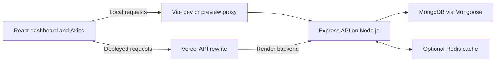

# FleetFlow

FleetFlow manages delivery-agent records through a React dashboard and an Express API. It supports agent registration, searching, filtering, pagination, details, partial editing, and confirmed deletion. Dashboard totals and recent registrations come from the API; there is no bundled demo dataset or automatic seed command.

This is an evaluation project with automated coverage, not a claim of production readiness. There is no authentication or authorization. A running application requires reachable MongoDB; Redis is optional. Live persistence/cache checks and deployed-browser acceptance remain outstanding.

## Guide

- [Features and status](#features-and-status)
- [Architecture and project layout](#architecture-and-project-layout)
- [Prerequisites and local setup](#prerequisites-and-local-setup)
- [Environment variables](#environment-variables)
- [API reference](#api-reference)
- [Redis caching and consistency](#redis-caching-and-consistency)
- [Tests and production build](#tests-and-production-build)
- [Deployment configuration](#deployment-configuration)
- [Troubleshooting and limitations](#troubleshooting-and-limitations)
- [Step 28 documentation verification](#step-28-documentation-verification)
- [Step 29 technical audit](#step-29-technical-audit)
- [Step 30 release readiness](#step-30-release-readiness)
- [Post-roadmap theme support](#post-roadmap-theme-support)
- [Historical development record](#historical-development-record)

## Features and status

| Area | Implemented behavior |
| --- | --- |
| Overview (`/`) | Total, active, and inactive counts across all registered records; five most recent registrations. Three list requests supply these values; there is no separate overview endpoint. |
| Agents (`/agents`) | Backend search, exact status/service-area filters, pagination, and View/Edit/Delete actions. Search covers business ID, name, phone, email, and service area. |
| Create | Required-field, phone, email, and status feedback; successful creation clears filters and returns to the first page to reload records. |
| Details and edit | `/agents/:id` and `/agents/:id/edit` use the database record ID. Editing prefills values and sends only changed editable fields; business ID is read-only. |
| Delete | Confirmation from the list or detail page. List deletion reloads the applied query; detail deletion returns to Agents. An emptied later page offers recovery to page one. |
| Request feedback | Initial loading, empty success, missing agents, safe errors, and manual retry/refresh. Same-query refreshes retain labelled prior data; changed filters/pages clear mismatched rows. |
| Request safety | Read cancellation and stale-response protection; retained failed create/edit drafts; guarded duplicate submissions. Mutations are never automatically retried. A lost response can mean a write succeeded, so check the record before resubmitting. |
| Themes | Dark by default; the header Dark/Light button switches instantly and saves an explicit preference in browser storage. All routes share the same palette. |
| Responsive shell | Shared navigation, mobile menu, keyboard focus styles, horizontal table scrolling, and a native modal deletion dialog. Current interactive/browser acceptance is not covered by ordinary Node tests. |

| Roadmap steps | Status and evidence |
| --- | --- |
| 1–24 | COMPLETE; historical evidence is retained below. |
| 25 | **PENDING**. Automated frontend-to-Express integration passes with mocked storage and Redis enabled/unavailable. Live MongoDB/Redis persistence and deployed-browser verification remain pending. |
| 26–27 | COMPLETE. Feedback and automated coverage are implemented; Step 27 records 136 backend and 107 frontend tests passing. |
| 28 | **COMPLETE**. Evaluator guide checked against source, examples/links audited, full test suites and production build rerun. |
| 29 | **COMPLETE**. Technical audit, cache regression fix, clean installs, full automated suites, build, syntax, and Git checks passed; see Step 29 below. |
| 30 | **COMPLETE**. Final local review, fresh tests/build and repository hygiene checks passed. Public repository access and basic backend HTTP health were checked; Step 25 live/browser acceptance remains pending. |

The [step plan](docs/STEP_PLAN.md) is the authoritative roadmap. Before changing the project, follow [the development rules](docs/DEVELOPMENT_RULES.md). Historical sections retain the statuses and limitations recorded at that time; this guide describes the current implementation.

## Architecture and project layout

The frontend uses React, Vite, Tailwind CSS, React Router, Axios, and Lucide icons. The backend uses Node.js, Express, Zod, Mongoose/MongoDB, dotenv, and node-redis. Exact dependency versions are resolved by each package's lockfile.



The shared client [api.js](client/src/lib/api.js) defaults to `/api` with a 10-second timeout. Services append `/agents` or `/agents/:id`. Development/preview forwards `/api` unchanged to the configured backend; Vercel uses its ordered API rewrite in production. Express validates requests before controller access. Cache misses and unavailable-cache reads use MongoDB. Successful mutations write MongoDB first, then attempt cache invalidation.

MongoDB holds one document per agent, addressed by an ObjectId. The Mongoose schema defines required fields, timestamps, and a unique business-ID index. List queries filter/search documents, count matches separately, and sort by `createdAt` descending with `_id` descending as a stable tie-breaker. No relational joins or database fallback when MongoDB is unavailable are implemented.

```text
client/
  package.json, package-lock.json    Frontend scripts and pinned dependencies
  .env.example                      Public client/proxy configuration
  vite.config.js, vercel.json        Development/preview proxy and production rewrites
  src/pages/                        Overview, list, detail/edit route lifecycles
  src/components/                   Layout, forms, table, details, feedback/dialog
  src/services/, src/lib/            Axios mapping and safe read error categories
  src/state/, src/validation/        Request/mutation state and form rules
  test/                             Rendering, lifecycle, proxy/Express checks
server/
  package.json, package-lock.json    Backend scripts and pinned dependencies
  .env.example                      Private server configuration template
  src/app.js, src/server.js          Express application and entry point
  src/startup.js, src/config/        MongoDB gating, Redis, validated settings
  src/routes/, src/controllers/     Five agent routes and handlers
  src/models/, src/validation/       Agent schema and API/phone/cache validation
  src/middleware/, src/utils/        Parsed validation and safe JSON errors
  src/services/                     List/detail caches and generation invalidation
  test/, test-support/               Tests, isolated storage and Redis helpers
  scripts/                          Opt-in live verification, separate from tests
docs/
  DEVELOPMENT_RULES.md, STEP_PLAN.md Development constraints and roadmap
```

## Prerequisites and local setup

Use **Node.js 24 or newer** and npm; both packages declare `node >=24`. Git is needed to clone the repository. Install dependencies in both packages, including for frontend tests: the frontend integration suite imports the backend app. There is no root `package.json` or root npm start command.

Provide reachable MongoDB (Atlas or a locally managed server) and a database URI. For Atlas, configure a database user with read/write/index permissions and allow the backend machine's network access. Include the intended database name in the URI and encode reserved characters in credentials. URI syntax validation does not verify credentials/connectivity. `npm ci` installs neither a MongoDB nor a Redis service.

### Install and configure

From a fresh checkout, run in PowerShell:

```powershell
git clone https://github.com/NatanshKhurana/FleetFlow.git
cd FleetFlow
npm ci --prefix server
npm ci --prefix client
if (-not (Test-Path server/.env)) { Copy-Item server/.env.example server/.env }
if (-not (Test-Path client/.env)) { Copy-Item client/.env.example client/.env }
```

For an existing checkout, start in its root and run the last four commands. The copy commands preserve existing local files. Privately replace the new server configuration's MongoDB placeholder before starting the API. The client example already uses `/api` and a port-5000 proxy target. Leave Redis blank to run without caching, or configure a private Redis URL. Never commit private environment files or put server credentials in browser variables.

Use the package templates: [server/.env.example](server/.env.example) and [client/.env.example](client/.env.example). The [root .env.example](.env.example) is a legacy planning template: neither package loads a root environment file in these commands, and `CLIENT_ORIGIN` is not read by the implementation. It does not configure CORS. Step 28 does not change any example file.

### Terminal 1: backend

From the repository root:

```powershell
cd server
npm start
```

Alternatively, `npm run dev` uses Node's source watch mode. `PORT` is required; **5000 is the example value, not a backend hardcoded default**. With that value, the API is at `http://localhost:5000/api`. MongoDB must connect before HTTP starts. Configured Redis connection failure is nonfatal and bounded; startup continues without caching. Stop with Ctrl+C.

After startup, check HTTP health from another terminal:

```powershell
Invoke-RestMethod -Uri 'http://localhost:5000/api/health'
```

`GET /api/health` returns `200` and `{"success":true,"message":"FleetFlow API is running"}`. It is a basic HTTP health endpoint, not a fresh database/Redis probe on every request.

### Terminal 2: frontend

From a separate terminal in the repository root:

```powershell
cd client
npm run dev
```

Open Vite's printed URL, normally `http://localhost:5173`; an occupied port can cause another port to be selected. `/api` requests go through Vite to `http://localhost:5000` by default, avoiding cross-origin browser requests. The shell can render without the API, but agent data cannot load. There is no login or automatic sample-data creation; use **Add new agent** or the API examples against an evaluation database. Stop with Ctrl+C.

For another backend port, update its `PORT` and the client's public `API_PROXY_TARGET` to the same origin, then restart both processes. Process variables override server file values. Restart the API after environment edits; source watch mode does not guarantee environment reload. Vite configuration changes require a restart, and browser environment changes require a new production build.

## Environment variables

These are the application-specific variables actually read by source code or the opt-in scripts. Supply private values through server file/process configuration or deployment secret settings; the examples below are deliberately non-sensitive.

| Variable | Component | Required? | Purpose and safe format/example |
| --- | --- | --- | --- |
| `PORT` | Backend `src/config/env.js` | Yes | Decimal TCP port 1–65535; example `5000`. No missing/blank fallback. Render may supply this process variable. |
| `MONGODB_URI` | Backend `src/config/env.js` | Yes | Driver-parseable MongoDB URI; local example `mongodb://127.0.0.1:27017/fleetflow`. `mongodb+srv://` is also supported. Hosted credentials stay private. |
| `REDIS_URL` | Backend configuration/Redis manager | Optional | Missing/blank disables Redis. Expected `redis://` or TLS `rediss://`; local example `redis://127.0.0.1:6379/0`. Malformed/unreachable values fall back without blocking startup. |
| `AGENT_LIST_CACHE_TTL_SECONDS` | Backend configuration and both caches | Optional | Default `60` when absent. Supplied text must be a positive decimal integer 1–86400 without leading zeros; blank is invalid. Applies to new list/detail entries, despite its existing list-specific name. |
| `VITE_API_BASE_URL` | Browser Axios client at build/dev time | Optional | Trimmed value; missing/blank defaults to `/api`. Keep `/api` for the supplied proxies/rewrites. Every `VITE_*` browser value is public. |
| `API_PROXY_TARGET` | Vite dev/preview configuration | Optional | Default `http://localhost:5000`. Public backend origin without `/api` suffix or credentials; not used by static assets or deployed Vercel rewrites. |
| `FLEETFLOW_TEST_MONGODB_URI` | `server/scripts/verify-crud.js` | Only for that opt-in script | Privately supplied process variable, same URI format as `MONGODB_URI`. No `.env` loading or fallback to application configuration. |
| `FLEETFLOW_TEST_REDIS_URL` | `server/scripts/verify-redis.js`, `verify-cache.js` | Only for those opt-in scripts | Privately supplied process variable, same Redis URL format as above. No `.env` loading or fallback to `REDIS_URL`. |

The backend explicitly resolves its own environment file relative to `src/config/env.js`, independent of launch directory. An absent file is allowed when process variables supply required values; an unreadable file fails startup. It validates before connecting/listening, prints fixed messages rather than supplied values, and passes the TTL through `app.locals`. Client configuration never loads the backend's private file.

## API reference

All API endpoints are under `/api`. Source: [app.js](server/src/app.js), [agentRoutes.js](server/src/routes/agentRoutes.js), [agentController.js](server/src/controllers/agentController.js), and [agentSchemas.js](server/src/validation/agentSchemas.js). No authentication, overview, login, bulk-delete, or PUT endpoint exists.

| Method | Path | Input | Successful result |
| --- | --- | --- | --- |
| GET | `/api/health` | None | `200`: `{success:true,message:"FleetFlow API is running"}` |
| POST | `/api/agents` | JSON creation fields below | `201`: `{success:true,message:"Agent created successfully",data:agent}` |
| GET | `/api/agents` | Optional query table below | `200`: `{success:true,message:"Agents retrieved successfully",data:agent[],pagination:{page,limit,total,totalPages}}` |
| GET | `/api/agents/:id` | Database record ID | `200`: `{success:true,message:"Agent retrieved successfully",data:agent}` |
| PATCH | `/api/agents/:id` | Record ID and one or more editable JSON fields | `200`: `{success:true,message:"Agent updated successfully",data:agent}` |
| DELETE | `/api/agents/:id` | Database record ID | `204`: no body and no JSON to parse |

Table shapes use `agent` as shorthand for the full public record below. `:id` accepts exactly 24 hexadecimal characters, including uppercase. It is **not** the business `agentId`. Responses expose `id`, `agentId`, `fullName`, `phone`, `email`, `serviceArea`, `status`, `createdAt`, and `updatedAt`; `_id`, `__v`, and other model metadata are omitted. JSON timestamps are ISO date-time strings; the UI displays them in UTC.

### Body validation and agent fields

| Field | Creation | PATCH | Rules |
| --- | --- | --- | --- |
| `agentId` | Required string | Not editable | Trimmed, nonblank, backed by the model's unique MongoDB index. No case-folding is applied. |
| `fullName` | Required string | Editable | Trimmed, nonblank. |
| `phone` | Required string | Editable | Trimmed; numeric syntax below. |
| `email` | Required string | Editable | Trimmed, lowercased, validated by the HTTP Zod email rule. |
| `serviceArea` | Required string | Editable | Trimmed, nonblank; no fixed area catalogue. |
| `status` | Optional; defaults to `active` | Editable when supplied | Trimmed `active` or `inactive` only. |

POST/PATCH use strict object schemas: unknown fields and database IDs/timestamps are rejected. PATCH requires at least one editable field, preserves omitted values, and never upserts a missing record. Only `agentId` has a unique index; phone/email may be shared. Index initialization is awaited before creation; credentials and permissions still determine whether real index creation succeeds.

Phone syntax permits digits, an optional leading `+`, spaces, hyphens, dots, and balanced parentheses around digit groups. Examples: `123`, `+1 202-555-0142`, `(020)7946 0958`, and `+91 98765 43210`. Letters, punctuation-only values, misplaced plus signs, and unmatched parentheses fail. There is no country-specific digit count, extension syntax, reachability check, or migration of legacy records. Frontend create/edit, API schemas, and the model preserve this rule.

### List query and overview

| Parameter | Default | Behavior |
| --- | --- | --- |
| `page` | `1` | Positive decimal integer without leading zeros; requested page is returned even beyond the last page. |
| `limit` | `10` | Positive decimal integer without leading zeros, maximum `100`. |
| `search` | Omitted | Trimmed literal substring, case-insensitive across `agentId`, `fullName`, `phone`, `email`, and `serviceArea`; maximum 200 characters. Regex metacharacters are escaped. |
| `status` | Omitted | Trimmed, exact `active` or `inactive`; supplied blank/unsupported values are invalid. |
| `serviceArea` | Omitted | Trimmed, exact and case-sensitive match; blank is ignored. |

Filters combine with search using AND. Blank search is ignored. Repeated/nested/unknown query keys and unsafe pagination offsets are rejected. No sort parameter is supported: descending `createdAt`, then descending `_id`, is fixed. `total` counts all matches, not just the page; `totalPages` is `ceil(total/limit)`, including zero for no matches. A valid page beyond the last returns `200` with an empty array and the requested page metadata.

The overview calls this route three times: `page=1&limit=5` for total/recent, then `page=1&limit=1&status=active` and `status=inactive` for counts. It rejects malformed/inconsistent results rather than inventing totals. Separate reads/cached queries are not an atomic snapshot during concurrent changes; a manual retry can be needed.

### Request and response examples

This manual PowerShell example **writes to your configured database**. Use disposable evaluation data, with the backend on the example port. Repeating a business ID returns `409`; use a new ID or delete the earlier example.

```powershell
$agentPayload = @{
  agentId = 'EVAL-001'
  fullName = 'Alex Example'
  phone = '+1 202-555-0142'
  email = 'alex@example.com'
  serviceArea = 'Central'
} | ConvertTo-Json
$createdAgent = Invoke-RestMethod -Method Post -Uri 'http://localhost:5000/api/agents' -ContentType 'application/json' -Body $agentPayload
$agentRecordId = $createdAgent.data.id
Invoke-RestMethod -Uri 'http://localhost:5000/api/agents?page=1&limit=10&search=Alex&status=active&serviceArea=Central'
Invoke-RestMethod -Uri "http://localhost:5000/api/agents/$agentRecordId"
Invoke-RestMethod -Method Patch -Uri "http://localhost:5000/api/agents/$agentRecordId" -ContentType 'application/json' -Body '{"status":"inactive"}'
Invoke-RestMethod -Method Delete -Uri "http://localhost:5000/api/agents/$agentRecordId"
```

Representative `201` creation response (illustrative ID/timestamps, not an observed live record):

```json
{
  "success": true,
  "message": "Agent created successfully",
  "data": {
    "id": "000000000000000000000001",
    "agentId": "EVAL-001",
    "fullName": "Alex Example",
    "phone": "+1 202-555-0142",
    "email": "alex@example.com",
    "serviceArea": "Central",
    "status": "active",
    "createdAt": "2026-10-19T00:00:00.000Z",
    "updatedAt": "2026-10-19T00:00:00.000Z"
  }
}
```

A successful list with no matches is distinct from an API failure:

```json
{
  "success": true,
  "message": "Agents retrieved successfully",
  "data": [],
  "pagination": { "page": 1, "limit": 10, "total": 0, "totalPages": 0 }
}
```

### Errors

| HTTP status | Actual behavior |
| --- | --- |
| `400` | Invalid body/ID/query: `success:false`, `message:"Request validation failed"`, and safe `details` containing `section`, `field`, `message`. Malformed JSON instead returns `message:"Invalid JSON request body"` without `details`. |
| `404` | Valid missing agent: `{success:false,message:"Agent not found"}`. Unmatched paths/methods: `{success:false,message:"Route not found"}`. |
| `409` | Duplicate creation: `message:"An agent with this agentId already exists"`. Update duplicate-key errors: `message:"Agent update conflicts with an existing record"`; the schema defines no additional unique fields. Both include `success:false`. |
| `413` | Oversized JSON: `{success:false,message:"Request body is too large"}`. |
| `500` | Unexpected database/server failure: `{success:false,message:"Internal server error"}`; raw driver errors and stacks are hidden. |

Invalid POST/PATCH phone syntax yields `400` with this field feedback:

```json
{
  "success": false,
  "message": "Request validation failed",
  "details": [{
    "section": "body",
    "field": "phone",
    "message": "Enter a phone number using digits, an optional leading +, spaces, hyphens, dots, or parentheses."
  }]
}
```

Frontend services validate public response shapes. Missing agents use separate feedback; malformed responses, HTTP/network failures, and timeouts never become fabricated empty success. Read retries only re-execute GETs. Failed create/edit inputs remain available, and no mutation retry interceptor is installed.

## Redis caching and consistency

[agentListCache.js](server/src/services/agentListCache.js), [agentDetailCache.js](server/src/services/agentDetailCache.js), and [agentCacheState.js](server/src/services/agentCacheState.js) implement optional cache-aside reads:

- Lists cache the complete public response/pagination together, including empty results. Cached rows exceeding the page limit or the remaining matching total at the requested offset are rejected and refilled from MongoDB. Keys contain a shared generation and a hash of normalized page/limit/search/status/service-area parameters; search text is not embedded in the key.
- Detail keys use lowercased record IDs. Entries include a generation and the public response. Invalid JSON/shapes/IDs/generations are misses, not trusted payloads.
- Payloads expire using `AGENT_LIST_CACHE_TTL_SECONDS` (default 60 seconds). Hits do not extend TTL. Generation metadata has no payload TTL; obsolete list payloads expire naturally.
- Only successful MongoDB mutations rotate the generation and delete the affected detail key. No collection-wide Redis scan/flush occurs. Invalid input, missing targets, and failed writes do not invalidate warm caches.
- Commands are bounded to approximately one second. Read/write failures return MongoDB data; failed invalidation does not undo a successful write. Local reads/fills bypass caching during invalidation. Failed invalidation latches local bypass until a later successful local invalidation; connectivity alone does not clear it.
- Pre-mutation fills retain their old generation and cannot be treated as fresh under a newer generation. A late detail fill can overwrite a newer entry physically, but its old generation forces a safe miss and database refill.

Redis startup connection attempts are bounded to three seconds. Missing/blank settings skip Redis; failed connection leaves the API usable if MongoDB works. Automatic reconnection/offline queuing are disabled. After runtime connection loss, restart the backend or explicitly reconnect through the existing manager; no background retry process or public reconnect endpoint exists.

API cache prefixes are `fleetflow:agents:list:v2:`, `fleetflow:agents:detail:v2:`, and metadata key `fleetflow:agents:cache:v2:generation`. Access needs GET/SET (including NX for generation initialization and expiry on payloads) plus DEL for affected details. Configure credentials/TLS privately.

Automated tests use fake Redis and controlled storage for hits/misses, expiry, errors, mutations, concurrent invalidation, and late fills. These do **not** establish live reliability or transactional consistency. MongoDB and Redis are not one transaction: in-flight reads can finish with old data, other instances can serve stale payloads after failed invalidation until TTL expiry, local bypass does not survive restart, and direct database writes bypass API invalidation. The owner previously reported Redis Cloud PING/PONG connectivity only; live cache expiry/invalidation remains unverified.

## Tests and production build

These are the actual package scripts. Use the specified directories; normal tests need no live credentials/services.

| Directory | Command | Purpose |
| --- | --- | --- |
| `server/` | `npm test -- --test-concurrency=1` | Full backend suite. The script is `node --test`; the CLI flag runs files sequentially, matching established verification. |
| `server/` | `npm start` / `npm run dev` | Normal API / source watch mode; these require MongoDB configuration. |
| `client/` | `npm test` | Full frontend suite, including Vite-to-Express checks. Install both packages first. |
| `client/` | `npm run build` | Vite production build into ignored `client/dist/`. |
| `client/` | `npm run preview` | Serve an existing build locally, normally `http://localhost:4173`, with the preview API proxy. Build first; this does not deploy the app. |

Useful focused commands are ad hoc Node commands, not extra npm scripts:

Inside `server/`:

```powershell
node --test test/cache-consistency.test.js test/cache-invalidation.test.js test/crud-flow.test.js
```

Inside `client/`:

```powershell
node --test test/backend-integration.test.js test/request-feedback.test.js test/proxy.test.js
```

From the repository root, a JavaScript syntax example and Git whitespace check:

```powershell
node --check server/src/app.js
git diff --check
```

There is no lint, seed, migration, browser-E2E, or combined root test npm script. Vite builds compile JSX; `node --check` is for applicable JavaScript. Backend tests exercise real routes/validation/controllers and mocked model storage/Redis; they do not enforce real MongoDB indexes. Frontend tests render React to strings and exercise resources/services over fixtures, including the real Express app. They do not execute browser clicks, native dialog focus, or deployed navigation. Cancellation, duplicate-write guards, phone validation, safe failures, retries, and stale responses have automated coverage.

### Opt-in live scripts

These existing scripts are separate from normal suites and were **not run in Step 28**. Set the named test variable privately in the process environment before running, inside `server/`:

| Script command | Required configuration and scope |
| --- | --- |
| `node scripts/verify-crud.js` | `FLEETFLOW_TEST_MONGODB_URI`; disposable randomly named collection, real indexes, and HTTP CRUD checks. Attempts exact collection cleanup; inspect cleanup output/exit status if interrupted or unsuccessful. |
| `node scripts/verify-redis.js` | `FLEETFLOW_TEST_REDIS_URL`; connectivity and PING/PONG only, no data writes. |
| `node scripts/verify-cache.js` | `FLEETFLOW_TEST_REDIS_URL`; isolated `fleetflow:verification:*` keys, list/detail hits, expiry/invalidation/late fills, and exact-key cleanup. No MongoDB or API mutations. Forced timeout can leave metadata; require exit code zero, including cleanup. |

The earlier `server/scripts/verify-create-agent.js` still exists as a legacy create-only check. Unlike the newer scripts, it loads private server configuration and starts services before testing a disposable collection. Prefer explicit-configuration `verify-crud.js` for a deliberate live CRUD check; neither was run here. A script's existence or a tested missing-configuration guard is not evidence its live checks passed.

## Deployment configuration

The existing arrangement is **Vercel frontend + Render backend**; Step 28 changes neither service. Repository files establish routing and package commands, not live dashboard settings or service health.

| Surface | Settings implied by the repository |
| --- | --- |
| Vercel | Use `client/` as project root, install its dependencies (`npm ci`), build with `npm run build`, and publish `dist/` relative to that root. Keep public `VITE_API_BASE_URL=/api` or unset it. Browser-variable changes require rebuilding/redeploying. |
| Render | Use `server/` as service root, install with `npm ci`, start with `npm start`, and use Node 24+. Supply private `MONGODB_URI`, platform `PORT`, optional `REDIS_URL`, and optional TTL in service configuration. MongoDB network access must allow the backend environment. |

[client/vercel.json](client/vercel.json) first rewrites `/api/:path*` to the already documented public backend origin `https://fleetflow-api-2fq1.onrender.com/api/:path*`, then `/(.*)` to `/index.html`. That order preserves API responses while supporting direct `/agents/:id` and edit navigation. `API_PROXY_TARGET` is dev/preview-only and cannot change the deployed rewrite destination.

An absolute `VITE_API_BASE_URL` bypasses the same-origin proxies/rewrites. Express does not enable cross-origin browser access via CORS; `CLIENT_ORIGIN` is not a supported switch. Keep `/api` for this deployment. No Render blueprint or live project settings are present in the repository, and a frontend deployment URL is not established here. Step 30 made limited read-only public checks: GitHub confirmed the expected public repository and the Render health endpoint returned its expected JSON with HTTP 200. No live settings or deployed frontend were inspected; these observations do not establish MongoDB/Redis health or production CRUD correctness.

## Troubleshooting and limitations

| Symptom | Checks supported by the implementation |
| --- | --- |
| API will not start | Use Node 24+, install `server/` dependencies, and privately replace the MongoDB placeholder. PORT and MONGODB_URI are required; supplied blank TTL is invalid. Process variables override file values. Never print secrets while diagnosing. |
| MongoDB connection failure | Check URI/database, user permissions, credential encoding, DNS/network reachability, and Atlas IP access where used. Connection has a 30-second server-selection timeout; HTTP waits for readiness. Redis cannot substitute for MongoDB. |
| Shell loads but data fails | Check the API's printed port and basic `/api/health` response. Match `API_PROXY_TARGET` to that origin, keep browser base `/api`, and restart Vite after changes. Error is not an empty database. |
| First-load failure or timeout | Record public request path, duration, status/content type, and timeout/connection category in browser Network tools without sharing secrets. Correlate with backend startup/request logs and database readiness, then retry manually. The 10-second browser deadline differs from an HTML/proxy/HTTP failure; a Render cold start has **not** been established as the cause. |
| Deployed API gets HTML, or detail-page refresh fails | Verify the live build's public base and whether API rewrite runs before SPA fallback. The local proxy is not shipped in static assets. A build is not a deployment/network check. |
| Redis warning or uncached reads | MongoDB requests remain usable. Check private connectivity/configuration/permissions; runtime recovery requires explicit reconnect/restart, and invalidation bypass may require a subsequent successful local mutation. Do not flush shared Redis data to diagnose the app. |
| Missing agent or invalid link | Use database `id`, not business `agentId`. A valid removed record is 404; malformed IDs are 400. Return to Agents and reload. |
| Failed/timed-out save | Drafts remain available, but a lost response does not prove the write failed. Check details/list before explicitly submitting again. Read retries do not repeat mutations. |
| Tests/build fail | Run from the correct package, use Node 24+, and install both lockfiles' dependencies with `npm ci`. Use sequential backend execution. Test ports are ephemeral; inspect actual assertions/exit codes without weakening tests or assuming a live-service issue. |

No authentication/authorization, rate limiting, or production security assurance is implemented. The public CRUD API is not access-controlled. Agents are configured database records, not seeded demo rows; tests use disposable dummy records. No live MongoDB CRUD/cache consistency, current Redis Cloud caching, multi-instance production correctness, or current deployed-browser/focus/viewport verification is claimed. Historical owner-reported manual checks apply only to the recorded step/conditions. The current production first-load issue remains unproven, and Step 25 remains PENDING for live/browser checks.

## Step 28 documentation verification

Step 28 is COMPLETE against its documentation acceptance criteria. The guide now covers the implemented features, architecture/database model, setup, all eight application/script environment variables, six API method/path pairs, safe examples, cache behavior, tests/build, Vercel/Render routing, and troubleshooting. The legacy root example's unused `CLIENT_ORIGIN` is identified without changing configuration. Historical status/verification text, including Steps 24–27, is retained unchanged below.

Checks performed on October 19, 2026, using Node 24.19.0 and npm 11.7.0:

| Directory/check | Command or method actually used | Result |
| --- | --- | --- |
| `server/` | `npm test -- --test-concurrency=1` | 136 passed, 0 failed, 0 skipped |
| `client/` | `npm test` | 107 passed, 0 failed, 0 skipped |
| `client/` | `npm run build` | Passed with Vite 8.3.4; 2,079 modules transformed |
| Repository root | `node --check server/src/app.js` | Passed |
| Documentation audit | Ad hoc Python checks against source/package files | All six API method/path pairs, eight documented variables, package scripts/engines, named current test/script files, and 25 local Markdown links checked |
| Examples | JSON parsing and PowerShell parser, without executing setup/API examples | Three JSON blocks and eight PowerShell blocks passed syntax checks |
| Diagram | Basic Mermaid flowchart grammar/structure check and manual source-flow review | Six declared nodes and six edges checked; visual rendering was not performed and no dependency was added |
| Preservation/scope | Compare historical text and numbered roadmap entries with Git HEAD | Historical status ledger and Step 2–27 verification suffix unchanged; numbered roadmap entries other than Step 28 unchanged |
| Repository root | `git diff --check` | Passed |

The documentation audits were temporary verification commands, not new project scripts, tests, or dependencies. Installation commands, example CRUD writes, ordinary configured backend startup, opt-in live scripts, and deployment operations were not executed. Full tests used their existing isolated fixtures; no real service credentials were needed. Diagram rendering, live MongoDB/Redis persistence/cache behavior, live Vercel/Render configuration and health, and current interactive/deployed-browser acceptance remain unverified. The earlier first-load failure has no established production root cause here.

Only `README.md` and `docs/STEP_PLAN.md` changed; runtime code, tests, lockfiles, environment examples, and hosting configuration are unchanged. No private environment file was inspected or modified. Step 25 remains PENDING for live/browser verification; Steps 29–30 remain PENDING. Nothing was staged, committed, or pushed.

Suggested commit after review: `docs: complete project setup and API documentation`

## Step 29 technical audit

Step 29 is COMPLETE for the local technical-audit acceptance criteria. The audit started on clean `main` at `185d611` on October 19, 2026, using Node 24.19.0 and npm 11.7.0. Step 25 remains **PENDING** for live MongoDB/Redis persistence and deployed-browser verification; Step 30 remains **PENDING**.

| Investigation | Evidence and outcome |
| --- | --- |
| Cached list pagination | Reproduced a valid-shaped cache hit returning a row with `total:0`, without querying MongoDB. The cache reader now rejects rows exceeding the remaining total at the page offset. A regression covers zero totals, pages beyond the last page, and an oversized final-page payload; each falls back to storage, repairs the entry with the existing TTL, and subsequently hits the repaired cache. Public API contracts, cache keys, TTLs, generation invalidation, and Redis fallback behavior are preserved. |
| Retry-test deadline | The first full frontend run failed a healthy-retry assertion (106 passed, 1 failed); the unchanged feedback file passed alone (9 tests). Its fixture applied a 200 ms deadline to healthy responses as well as deliberate hangs. Only deliberate timeout modes now use 200 ms; other modes restore the existing 10-second client deadline, with explicit assertions. No production timeout or failure assertion was weakened. The cold parallel run is consistent with timing sensitivity, but the original failure did not record its error category. |
| Frontend requests and CRUD | Reviewed routes, shared Axios/services, request/mutation resources, forms, phone validation, loading/empty/error/404 states, duplicate guards, cancellation, and stale responses. Existing automated CRUD and proxy checks passed with controlled storage and Redis enabled/unavailable. No additional runtime defect was demonstrated in these areas. |
| Backend and configuration | Reviewed route/validation/error/model/startup behavior, cache races/invalidation/fallback, required configuration, health handling, and ordered Vercel/Vite routing. No additional reproducible defect warranted a change. Hosting and environment configuration remain unchanged. |
| Production first-load report | No production request trace, live Render logs, or deployed browser session was available. Neither this cache defect nor Render cold starts are established as its cause. Capture sanitized request path/timing/status/content type and correlate backend startup/request logs before drawing a conclusion. |

Verification performed after the fixes (all final runs exited zero, with no skipped or cancelled tests):

| Directory/check | Exact command or method | Result |
| --- | --- | --- |
| `server/` | `npm ci` | 91 packages added, 92 audited, 0 reported vulnerabilities |
| `client/` | `npm ci` | 67 packages added, 68 audited, 0 reported vulnerabilities |
| `server/` | `node --test test/list-agents.test.js test/cache-invalidation.test.js test/cache-consistency.test.js test/crud-flow.test.js` | 45 passed, 0 failed, 0 skipped |
| `client/` | `node --test test/request-feedback.test.js test/backend-integration.test.js test/proxy.test.js` | 16 passed, 0 failed, 0 skipped |
| `server/` | `npm test -- --test-concurrency=1` | 137 passed, 0 failed, 0 skipped |
| `client/` | `npm test` | 107 passed, 0 failed, 0 skipped |
| `client/` | `npm run build` | Vite 8.3.4 passed; 2,079 modules transformed |
| Repository root | `node --check` on each path from `git ls-files '*.js'` | All 61 JavaScript files passed; build also compiled JSX |
| Static source audit | Resolve tracked relative JS/JSX imports without executing modules | 162 relative imports resolved |
| Secret/ignore audit | Tracked filenames plus high-signal credential-pattern scan of 89 tracked source/document files; `git check-ignore --no-index --quiet` on private env/dependency/build paths | No tracked private-file candidates or credential-pattern candidates; private environment files, dependencies, and client build output are ignored. No real secret file was opened or modified. This limited scan is not a security certification. |
| Documentation/Git | Local documentation links, historical/roadmap preservation, complete diff/scope review, `git diff --check`, `git diff --stat`, `git status --short` | Passed; only the five intended files changed; nothing staged |

The new backend regression was first run before the runtime fix with `node --test test/list-agents.test.js`: 18 passed and 1 failed, reproducing the invalid cache hit. After the fix it passes in both focused and full suites. The feedback fixture retains real HTTP timeout/network/HTML/503 coverage, successful manual retries, and timed-out mutation draft/duplicate-submission assertions.

Changed files: `server/src/services/agentListCache.js`, `server/test/list-agents.test.js`, `client/test/request-feedback.test.js`, `README.md`, and `docs/STEP_PLAN.md`. No dependencies, lockfiles, environment examples, hosting settings, API contracts, database schemas, or phone rules changed. Nothing was staged, committed, pushed, or deployed.

Automated tests use controlled model storage and fake Redis; they do not prove live indexes/persistence, real cache expiry/invalidation, or deployed network behavior. Browser interaction, native dialog focus, viewport behavior, current Vercel/Render configuration/health, and live service scripts remain unverified. Existing nontransactional cache limitations above still apply; overview/list counts are separate database reads, not atomic snapshots. No additional unresolved defect was identified in the changed code. Step 30 was not started.

Suggested commit after review: `fix: resolve final verification issues`

## Step 30 release readiness

The final review of the 30-step roadmap is COMPLETE, with outstanding live verification explicitly retained in **Step 25: PENDING**. Steps 1-24 and 26-29 remain COMPLETE. FleetFlow is ready for evaluation of its documented implementation and automated coverage; production acceptance is qualified by the limitations below.

The review began on clean `main` at `2224ea2` (`fix: resolve final verification issues`). Tracking is `origin/main`; `git rev-list --left-right --count 'HEAD...@{upstream}'` returned `0 0` against the local tracking reference. No fetch or push was performed, so this does not prove remote branch freshness.

Reviewed the current CRUD routes/services, overview counts, query/phone validation, request loading/empty/error/retry/cancellation behavior, mutation guards and retained drafts, public response/error shapes, optional Redis fallback and generation invalidation, setup variables/scripts, Vite proxy and Vercel API-before-SPA rewrites. Documentation matches these implementations; no further reproducible runtime defect was found. No application code, tests, dependencies, lockfiles, hosting settings, or environment files changed in Step 30.

Fresh checks on October 19, 2026 (Node 24.19.0, npm 11.7.0):

| Directory/check | Command or method executed | Result |
| --- | --- | --- |
| `server/` | `npm test -- --test-concurrency=1` | 137 passed, 0 failed, 0 skipped, 0 cancelled |
| `client/` | `npm test` | 107 passed, 0 failed, 0 skipped, 0 cancelled |
| `client/` | `npm run build` | Passed; Vite 8.3.4, 2,079 modules transformed |
| Repository root | `node --check` for every path from `git ls-files '*.js'` | 61 passed; JSX compiled by the build |
| Static audit | Ad hoc Python checks of Git-tracked source/docs, relative imports, local links, package manifests/lockfile roots and ignored paths | 89 files scanned with zero high-signal secret candidates; 162 imports resolved; 14 local links resolved before this section was added. No tracked private-file or generated dependency/build candidates; ignore checks passed. No real secret file was opened or modified. This is a limited hygiene check, not a complete security audit. |
| Public repository | Read-only Python `urllib.request` GET to `https://api.github.com/repos/NatanshKhurana/FleetFlow` | HTTP 200 JSON; expected repository name and public visibility confirmed |
| Basic backend health | Read-only Python `urllib.request` GET to `https://fleetflow-api-2fq1.onrender.com/api/health` | HTTP 200 JSON; exact expected health body confirmed. No agent endpoint was called and no data was written. |
| Documentation/Git | Local links, status/history preservation and complete diff review; `git diff --check`, `git diff --stat`, `git status --short` | Passed; only README.md and docs/STEP_PLAN.md changed; nothing staged |

Public probes used a 15-second timeout and no credentials. Their successful responses are point-in-time observations, not a guarantee of availability. The health handler does not probe MongoDB or Redis. No live CRUD/persistence/index tests, Redis expiry/invalidation checks, Vercel frontend/browser navigation, focus/viewport checks, dashboard settings, or Render logs were verified. Opt-in live scripts were not run because a safe disposable live environment was not established. The earlier production first-load failure still has an unknown cause; neither this review nor a successful health response proves it fixed.

Existing limitations remain: no authentication/authorization or rate limiting; lost mutation responses can require checking records before resubmission; overview/count reads and cross-store cache updates are nontransactional. See [troubleshooting and limitations](#troubleshooting-and-limitations) and the opt-in live scripts above. Complete Step 25's persistence/cache and deployed-browser checks separately before claiming end-to-end production acceptance.

Only final status/verification documentation was updated. Earlier step records are preserved as historical evidence. Nothing was staged, committed, pushed, deployed, restarted, or reconfigured. Suggested commit after review: `chore: finalize FleetFlow release readiness`.

## Post-roadmap theme support

First-time visitors receive **Dark Mode**, regardless of operating-system preference. Use the **Dark/Light** Sun/Moon button in the header to switch without reloading. It is a native keyboard-operable button labelled "Color theme: Dark" or "Color theme: Light", with pressed state, visible focus outline, and fixed width; the header can wrap on narrow screens. Explicit choices persist in `localStorage` under `fleetflow.theme`. Invalid or unavailable storage defaults safely to dark; when saving is blocked, switching still works for the current page.

A local blocking `public/theme.js` script sets the root `data-theme` before React starts; the HTML and CSS also default to dark to avoid an initial light flash. One shared store notifies only the theme control. Central semantic Tailwind/CSS tokens cover the shell/navigation, overview, list/filter/pagination, details, create/edit forms, delete dialog/backdrop, statuses, errors, empty/loading feedback, and native input color scheme. Switching does not remount routes, dispatch API requests, or clear drafts/filters/data.

Verification: `node --test test/theme.test.js test/layout.test.js test/agent-detail.test.js` in `client/` passed **29 tests**; full `npm test` passed **115 tests**, all with zero failures/skips/cancellations. Eight new theme tests cover defaults, switching and actual click handlers, persistence, invalid/blocked storage, retained resources/drafts and request counts, route control markup, and palette contrast. An existing detail rendering assertion now expects the semantic text token; its field/timestamp/status checks remain intact. The initial full run caught that old color-class assertion (113 passed, 1 failed) before correction.

`npm run build` passed with 2,080 modules transformed. `node --check` passed for `client/public/theme.js`, `client/test/theme.test.js`, and the changed `client/test/agent-detail.test.js`; `git diff --check` passed. Built output contains the bootstrap and both palettes. Token checks establish 4.5:1 text/status/button contrast and 3:1 input-border/focus contrast for the tested pairs; they are not a full accessibility audit. Browser automation reported no available browsers, so rendered visual quality, actual keyboard/focus interaction, native dropdown/dialog appearance, and viewport behavior still need manual browser checks in both modes. Responsive classes and accessible markup were inspected/tested, not visually verified. The backend suite was not rerun for this frontend-only feature; the full client suite includes existing isolated Express integration tests.

No dependencies, backend/API behavior, environment files, hosting configuration, or original roadmap statuses were changed. Step 25 remains PENDING and Step 30 remains COMPLETE. Earlier verification records below retain their historical scope. Suggested commit: `feat: add persistent dark and light themes`. Changes remain uncommitted for review.

## Historical development record

The historical status ledger and verification notes below are preserved from the previous README, including Steps 24–27 and the phone-validation correction. They describe historical implementation states, commands, results, and limitations. Old pending statuses, disabled-action descriptions, and test counts are time-specific records; the guide above and current roadmap take precedence for present setup. These historical notes have not been rewritten or removed.

<details>
<summary>Expand historical verification notes (Steps 2–27)</summary>

## Current setup status

**The backend supports creating, listing, retrieving, partially updating, and deleting agents.** List requests support pagination/search/filters; detail, update, and delete requests use the public database ID. The backend connects to MongoDB Atlas before accepting HTTP requests and reuses the Agent model, request validation, and centralized errors. The frontend provides the API-backed overview, searchable/filtered/paginated Agents page, creation form, individual details, prefilled editing, and confirmed deletion.

- Step 1 is COMPLETE and committed locally as `0f170dc` (`chore: initialize FleetFlow project structure`).
- Step 2 is COMPLETE and committed locally as `e5ad3ec` (`feat: set up Express server and health check`).
- Step 3 is COMPLETE and committed locally as `ee4870c` (`chore: configure environment variables`).
- Step 4 is COMPLETE and committed locally as `9e814f5` (`feat: connect application to MongoDB`).
- Step 5 is COMPLETE and committed locally as `4fa2766` (`feat: define delivery agent data model`).
- Step 6 is COMPLETE and committed locally as `772929d` (`feat: add request validation and API errors`).
- Step 7 is COMPLETE and committed locally as `d516a14` (`feat: add create agent API`).
- Step 8 is COMPLETE and committed locally as `e50b52d` (`feat: add paginated agent list API`).
- Step 9 is COMPLETE and committed locally as `31671be` (`feat: add get agent by ID API`).
- Step 10 is COMPLETE and committed locally as `7e699d9` (`feat: add update agent API`).
- Step 11 is COMPLETE and committed locally as `a40ea0e` (`feat: add delete agent API`).
- Step 12 is COMPLETE and committed locally as `c57405e` (`test: strengthen CRUD API coverage`). Its optional live MongoDB script has not been run.
- Step 13 is COMPLETE and committed locally as `25c803f` (`feat: configure Redis connection`). The project owner subsequently verified Redis Cloud with `node scripts/verify-redis.js`, reporting successful connection and PING/PONG.
- Step 14 is COMPLETE and committed locally as `0977418` (`feat: cache agent list responses in Redis`). Live list-cache behavior has not been tested by the agent.
- Step 15 is COMPLETE and committed locally as `09580c8` (`feat: cache individual agent responses`). Live detail-cache behavior has not been tested by the agent.
- Step 16 is COMPLETE and committed as `b8f8ec9` (`fix: invalidate stale agent cache entries`), with status documentation committed as `95aeef9`. Its verification results remain recorded below.
- Step 17 is COMPLETE and committed as `f4d9846` (`test: verify Redis caching and consistency`). Live cache verification has not been run.
- Step 18 is COMPLETE and committed as `e170c33` (`feat: set up React dashboard application`).
- Step 19 is COMPLETE and committed as `f90d653` (`feat: build responsive admin dashboard layout`). The project owner confirmed manual browser viewport and keyboard verification passed.
- Step 20 is COMPLETE and committed as `b5d958e` (`feat: add agent dashboard overview`), including the port-5000 proxy alignment.
- Step 21 is COMPLETE and committed as `36ecb01` (`feat: build searchable agent management table`). Its verification results remain recorded below.
- Step 22 is COMPLETE and committed as `7ce23a9` (`feat: add delivery agent creation form`). Its verification results remain recorded below.
- Step 23 is COMPLETE and committed as `9e1f9a6` (`feat: add agent details view`). Its verification results remain recorded below.
- Step 24 is COMPLETE after 77 focused tests, all 91 frontend tests, the production build, syntax checks, and Git checks passed. Editing and confirmed deletion use the existing PATCH/DELETE contracts. Browser interactions and live persistence were not verified in this step; changes remain uncommitted for review.
- Step 25 remains PENDING in `docs/STEP_PLAN.md`. Automated frontend-to-Express integration through the Vite proxy passes with Redis enabled and unavailable; live MongoDB/Redis persistence and browser/deployment verification remain pending. See the Step 25 verification section below for results and limitations. Steps 28-30 remain PENDING.
- Step 26 is COMPLETE: shared read feedback distinguishes initial loading, refresh, cancellation, timeout/network failure, empty success, and missing agents. All 103 frontend tests and the production build passed; see the Step 26 section for the first-load investigation and limitations.
- Step 27 is COMPLETE: seven additional cases cover warm-cache request rejection, reversed late-fill ordering, failed post-mutation reads, and refresh cancellation/stale errors. All 136 backend tests, 107 frontend tests, and the production build passed. Runtime code is unchanged.
- The server exposes health, create-agent, list-agent, single-agent GET, PATCH, and DELETE endpoints with consistent JSON error responses. Successful deletion returns 204 with no body, as required by the roadmap.
- Express, dotenv, Zod, Mongoose, and node-redis are the direct dependencies. The development script uses Node's built-in watch mode.
- `client/` contains a responsive dashboard shell, API-backed overview, searchable/filtered/paginated Agents list, creation/edit forms, individual details, and delete confirmation with loading/not-found/error/retry handling. List and single-agent GET endpoints use optional Redis caching with a shared default 60-second TTL and invalidation after successful mutations. There is no authentication. Normal tests use mocked services; dedicated live cache expiry/invalidation checks remain unperformed.
- The backend loads `server/.env` and requires valid PORT and MongoDB URI configuration. Existing private configuration is preserved. Redis remains optional because caching must not prevent database-backed API startup.

## Step 2 verification

Actual checks run on October 18, 2026:

| Command or check | Actual result |
| --- | --- |
| `npm install express` in `server/` | Installed successfully; npm audited 66 packages and reported 0 vulnerabilities |
| `npm ls --depth=0` in `server/` | Only `express@5.3.0` is a direct dependency |
| `node --check server/src/app.js` and `node --check server/src/server.js` from the root | Both syntax checks passed |
| `npm run dev` in `server/` | Server started at `http://localhost:5000` |
| PowerShell here-string piped to `node --input-type=module`, using native `fetch` and `node:assert/strict` | Health: 200; unknown route: 404; malformed JSON: 400; oversized JSON: 413. All statuses, JSON content types, and exact response bodies passed assertions |
| `npm start` in `server/`, followed by `node --input-type=module -e` with native fetch/assert | Server started; health returned 200 and the exact expected JSON |

Both Step 2 verification servers were stopped with Ctrl+C afterward. At Step 2 there was no persistent automated test suite; the checks above were live HTTP smoke checks. The unexpected-error 500 branch was inspected but not deliberately triggered. Database, Redis, CRUD, authentication, and frontend tests were outside that step.

## Step 3 verification

Actual checks run on October 18, 2026:

| Command or check | Actual result |
| --- | --- |
| `npm install dotenv zod` in `server/` | Added two packages; npm audited 68 packages and reported 0 vulnerabilities |
| `npm ls --depth=0` in `server/` | Express 5.3.0, dotenv 18.0.8, Zod 4.6.7 |
| `node --check` for `src/config/env.js`, `src/server.js`, `src/app.js`, and `test/env.test.js` in `server/` | All syntax checks passed |
| `npm test` in `server/` | Four tests passed: file loading independent of launch directory; process-variable precedence; missing file with valid process port, including 1 and 65535; rejection of missing and invalid ports without printing submitted values |
| `npm run dev` using a local copy of `server/.env.example` | Server started on port 5000 without MongoDB or Redis credentials |
| PowerShell here-string piped to `node --input-type=module`, using native fetch/assert | Health 200, unknown route 404, malformed JSON 400, oversized JSON 413; exact JSON and content types passed |
| Child-process smoke check piped to `node --input-type=module`, running `src/server.js` with an invalid process PORT | Exited 1 before listening; printed a clear PORT error without echoing the submitted value |
| `git check-ignore -v` for backend environment files and dependencies | `.env`, `.env.local`, and `node_modules/` ignored; `.env.example` allowed |

The development server was stopped afterward. A safe local `server/.env` copy remains ignored by Git. The 500 branch remains untriggered; `app.js` was preserved. No MongoDB or Redis connections were attempted. Step 3 acceptance criteria passed; no known blocker remains.

## Step 4 verification

Actual checks run on October 18, 2026. Default `npm test` uses fake configuration and database mocks; it never reads private credentials or requires a live database. The Atlas checks below were separate integration checks using the existing private `.env` without modifying it.

| Command or check | Actual result |
| --- | --- |
| `npm install mongoose` in `server/` | Added Mongoose 9.11.2 and supporting packages; audited 86 packages, reported 0 vulnerabilities |
| `npm test` in `server/` | 16 tests passed after correcting a test mock that stalled the initial run |
| `node --check` for all changed/new JavaScript files | Passed |
| `git check-ignore -v` for backend environment files and dependencies | Secret environment files and dependencies ignored; backend example file remains eligible for Git |
| PowerShell here-string piped to `node --input-type=module`, importing the real startup function and private local configuration | Real Atlas connection and database ping passed; health returned exact JSON with 200; unknown route returned JSON 404; cleanup completed |
| `npm start`, followed by native fetch/assert HTTP check | Real Atlas startup succeeded and health returned 200; Ctrl+C closed Mongoose |
| Separate controlled child-process check against an unavailable loopback MongoDB endpoint | Exited 1 after connection timeout; HTTP unavailable before and after failure; no URI printed |
| Separate child processes invoking SIGINT and SIGTERM handlers after real Atlas startup | Both closed Mongoose and exited 0. Handlers were invoked with `process.emit` because Windows process termination does not deliver Unix signals in the same way |

The configured Atlas URI and credentials were never printed. All verification servers and clients were closed afterward. Step 4 acceptance criteria passed; no known blocker remains. Existing JSON 400 and 413 responses are also covered by the startup tests; the 500 response branch was not deliberately triggered.

## Step 5 verification

Actual checks run on October 18, 2026, inside `server/`:

| Command | Actual result |
| --- | --- |
| `node --test test/agent.test.js` | All 8 Agent tests passed. The first run warned about deprecated `validateSync()`; tests were changed to async `validate()` and rerun successfully without those warnings. |
| `node --check src/models/Agent.js` | Passed |
| `node --check test/agent.test.js` | Passed |
| `npm test` | All 24 tests passed, including the 8 new model tests and 16 existing configuration, connection, and startup tests |

Agent tests cover valid active/inactive documents, each missing required field, empty/whitespace/null required values, invalid status, default status, trimming, lowercase email, timestamp configuration, and the intended unique index. No dependencies were added. No live database was used, no secrets were read from `server/.env`, and no indexes or records were created. Database duplicate enforcement and timestamp persistence were not integration-tested; the schema definitions are verified. Step 5 acceptance criteria passed; no known blocker remains.

## Step 6 verification

Actual commands run inside `server/` on October 18, 2026:

| Command | Actual result |
| --- | --- |
| `node --test test/request-errors.test.js` | 8 passed after correcting an assertion to inspect logged arguments rather than the test runner's mock metadata |
| `node --check src/app.js` | Passed |
| `node --check src/utils/ApiError.js` | Passed |
| `node --check src/middleware/validateRequest.js` | Passed |
| `node --check src/middleware/errorHandler.js` | Passed |
| `node --check test/request-errors.test.js` | Passed |
| `npm test` | All 32 tests passed, including all 24 existing tests |

New tests cover valid/invalid body data, chained params and query validation, async schemas, raw Zod errors, application error status codes, safe unexpected 500 responses, hidden 5xx details, and already-started-response delegation. Existing startup tests continue verifying health 200, unknown-route 404, malformed JSON 400, oversized JSON 413, and database-startup failures. No live database or Redis was used, no dependencies were added, and `server/.env` was not read or changed. Step 6 acceptance criteria passed; no known blocker remains.

## Step 7 verification

Actual commands run inside `server/` on October 18, 2026:

| Command | Actual result |
| --- | --- |
| `node --test test/create-agent.test.js` | 8 focused tests passed with model initialization/writes mocked |
| `npm test` | All 40 tests passed, including all 32 previous tests; no live database required |
| `node --check src/app.js` | Passed |
| `node --check src/controllers/agentController.js` | Passed |
| `node --check src/routes/agentRoutes.js` | Passed |
| `node --check src/validation/agentSchemas.js` | Passed |
| `node --check test/create-agent.test.js` | Passed |
| `node --check scripts/verify-create-agent.js` | Passed |
| `node scripts/verify-create-agent.js` | Real Atlas gated startup, health 200, create 201, direct stored-document/timestamp checks, and duplicate 409 all passed; disposable collection removed and connections closed |
| `npm start`, then native fetch/assert through `node --input-type=module -e` | Existing MongoDB-gated startup succeeded; health returned exact JSON with 200; Ctrl+C closed Mongoose afterward |

The route tests verify normalization, the model's default status, safe generated database IDs, rejection of missing/invalid/extra data, index readiness, duplicate conflicts, safe unexpected errors, and preserved health/404 behavior. The opt-in check used real Mongoose persistence against an isolated collection by redirecting model methods; it did not test writes into the normal agents collection. Existing regression tests also passed for malformed JSON, oversized bodies, and database startup failures. No dependencies were added, no private configuration was printed or modified, and no commit was created. Step 7 acceptance criteria passed; no known blocker remains.

## Step 8 verification

Actual commands run inside `server/` on October 18, 2026:

| Command | Actual result |
| --- | --- |
| `node --test test/list-agents.test.js test/create-agent.test.js` | 17 tests passed: 9 new list tests and 8 create regression tests |
| `npm test` | All 49 tests passed, including all existing health, 404, parser-error, validation, and startup regressions |
| `node --check src/controllers/agentController.js` | Passed |
| `node --check src/routes/agentRoutes.js` | Passed |
| `node --check src/validation/agentSchemas.js` | Passed |
| `node --check test/create-agent.test.js` | Passed |
| `node --check test/list-agents.test.js` | Passed |

The old create regression test's expectation that list GET was unimplemented was updated; single-agent read, update, and delete still return 404. No dependencies were added. Model calls were mocked, so this step does not claim real MongoDB filtering or pagination integration coverage. No private environment file was read or modified, and no Atlas verification script was run. Step 8 acceptance criteria passed; no known blocker remains.

## Step 9 verification

Actual commands run inside `server/` on October 18, 2026:

| Command | Actual result |
| --- | --- |
| `node --test test/get-agent.test.js test/create-agent.test.js test/list-agents.test.js` | 22 tests passed: 5 new detail tests plus all create/list regression tests |
| `npm test` | All 54 tests passed, including existing health, 404, parser-error, validation, and startup checks |
| `node --check src/controllers/agentController.js` | Passed |
| `node --check src/routes/agentRoutes.js` | Passed |
| `node --check src/validation/agentSchemas.js` | Passed |
| `node --check test/create-agent.test.js` | Passed |
| `node --check test/get-agent.test.js` | Passed |

The earlier test that treated a single-agent GET as unimplemented was updated to use an actually unknown nested route. Update and delete still return 404. No dependencies were added; create/list implementations, the Agent model, app startup, and shared middleware were preserved. All database lookups were mocked: no real database check was run, no Atlas script was executed, and `server/.env` was not read or changed. Step 9 acceptance criteria passed; no known blocker remains.

## Step 10 verification

Actual commands run inside `server/` on October 18, 2026:

| Command | Actual result |
| --- | --- |
| `node --test test/update-agent.test.js` | All 10 focused tests passed |
| `npm test` | All 64 tests passed, including create/list/detail, health/404, malformed JSON/oversized body, configuration, and startup regressions |
| `node --check src/controllers/agentController.js` | Passed |
| `node --check src/routes/agentRoutes.js` | Passed |
| `node --check src/validation/agentSchemas.js` | Passed |
| `node --check test/create-agent.test.js` | Passed |
| `node --check test/update-agent.test.js` | Passed |

`git diff --check` from the root also passed. HTTP tests mock model updates and assert the targeted update options and supplied fields. A separate test runs real Mongoose timestamp and validation middleware against a mocked collection operation: `updatedAt` is added, omitted editable fields stay out of `$set`, `createdAt` remains unchanged, and invalid status fails before the collection call. These are isolated tests, not live MongoDB persistence checks. No dependencies were added, `server/.env` was not read or changed, and no Git staging or commit command was run. Step 10 acceptance criteria passed; no known blocker remains. DELETE is still unimplemented.

## Step 11 verification

Actual commands run inside `server/` on October 18, 2026:

| Command | Actual result |
| --- | --- |
| `node --test test/delete-agent.test.js` | All 5 focused tests passed; the initial run took longer to report output and also finished successfully. A repeat passed. |
| `node test/delete-agent.test.js` | All 5 tests passed directly while checking delayed runner output |
| `npm test` | All 69 tests passed, including existing create/list/detail/update, health/404, parser-error, configuration, and startup checks |
| `node --check src/controllers/agentController.js` | Passed |
| `node --check src/routes/agentRoutes.js` | Passed |
| `node --check test/create-agent.test.js` | Passed |
| `node --check test/delete-agent.test.js` | Passed |

`git diff --check` from the root also passed. The previous test that expected DELETE to be unimplemented now checks unknown nested DELETE paths and the absent-ID path. All deletion database calls were mocked; no live MongoDB persistence check was performed. No dependencies were added, `server/.env` was not read or changed, and nothing was staged or committed. Step 11 acceptance criteria passed; no known blocker remains. Step 12 and later steps remain pending.

## Step 12 verification

Actual commands run inside `server/` on October 18, 2026:

| Command | Actual result |
| --- | --- |
| `node --test test/crud-flow.test.js test/integration-script.test.js` | First run: 1 passed, 1 failed because the new mock cloned an ObjectId without its prototype. The mock now stores plain string IDs; rerun: both tests passed. No production code change was needed. |
| `npm test` | All 71 tests passed, including all 69 existing tests |
| `node --check test-support/crudFlow.js` | Passed |
| `node --check test/crud-flow.test.js` | Passed |
| `node --check test/integration-script.test.js` | Passed |
| `node --check scripts/verify-crud.js` | Passed |

`git diff --check` from the repository root also passed. The existing coverage audit and the new shared lifecycle verify successful requests, validation failures, duplicates, and missing records across all five endpoints. Database operations in the normal suite are mocked; the optional script's configuration guard was tested without connecting, but its live MongoDB execution/cleanup remains unverified. No private `.env` was read or changed. No dependencies or API behavior changed, and nothing was staged or committed. Step 12 acceptance criteria passed using automated HTTP integration with mocked database operations. Steps 13-30 remain pending.

## Step 13 verification

Actual commands run inside `server/` on October 18, 2026:

| Command | Actual result |
| --- | --- |
| `npm install redis` | Added redis 6.3.0 and supporting packages (6 packages total); npm audited 92 packages and reported 0 vulnerabilities |
| `npm ls --depth=0` | Express 5.3.0, dotenv 18.0.8, Zod 4.6.7, Mongoose 9.11.2, redis 6.3.0 |
| `node --test test/redis.test.js test/startup.test.js test/env.test.js` | Initial 24 focused tests passed |
| `node --test test/redis.test.js test/startup.test.js test/env.test.js test/integration-script.test.js` | Final 27 focused tests passed, including the additional cleanup-failure and optional-script checks |
| `node --test test/redis.test.js` | All 9 passed after final review added explicit-reconnect cleanup of a previously lost client; affected syntax checks were also rerun |
| `npm test` | All 87 tests passed, including all existing CRUD and HTTP regressions |
| `node --check src/config/redis.js` | Passed |
| `node --check src/config/env.js` | Passed |
| `node --check src/startup.js` | Passed |
| `node --check test/redis.test.js` | Passed |
| `node --check test/startup.test.js` | Passed |
| `node --check test/env.test.js` | Passed |
| `node --check test/integration-script.test.js` | Passed |
| `node --check scripts/verify-redis.js` | Passed |

`git diff --check` from the repository root also passed. Tests used fake Redis clients; malformed-URL handling used the installed real client without connecting. The optional PING script's missing-configuration guard passed; the agent did not perform live Redis integration during Step 13. MongoDB gating, health responses after Redis failure, startup cancellation, and repeatable cleanup were verified with injected services. `server/.env` was not read or changed. No caching, endpoint changes, staging, or commits were added in Step 13. After that step was committed, the project owner reported a successful Redis Cloud connection and PING/PONG using `node scripts/verify-redis.js`.

## Step 14 verification

Actual commands run inside `server/` on October 18, 2026:

| Command | Actual result |
| --- | --- |
| `node --test test/list-agents.test.js test/env.test.js test/startup.test.js` | All 35 focused tests passed |
| `npm test` | Initial run: 96 passed, 1 failed because the existing optional CRUD-script guard exceeded its 5-second child-process timeout. That test-only timeout was raised to 15 seconds without changing its assertions or any application timeout. Final rerun: all 97 tests passed. |
| `node --test test/list-agents.test.js test/env.test.js test/startup.test.js test/integration-script.test.js` | All 37 focused tests passed after the guard-timeout correction |
| `node --check src/services/agentListCache.js` | Passed |
| `node --check src/controllers/agentController.js` | Passed |
| `node --check src/config/env.js` | Passed |
| `node --check src/startup.js` | Passed |
| `node --check test/list-agents.test.js` | Passed |
| `node --check test/env.test.js` | Passed |
| `node --check test/startup.test.js` | Passed |
| `node --check test/integration-script.test.js` | Passed |

`git diff --check` from the root also passed. The 9 new list-cache tests exercise the production route with fake Redis and mocked MongoDB; the new TTL configuration test and existing startup test verify validation/defaults/overrides and propagation to Express. Default expiry is verified by fake-clock behavior and the Redis SET expiration argument, not by waiting on a live Redis server. No live cache integration was performed. The project owner's reported Redis Cloud PING/PONG remains connectivity evidence only. No dependencies, invalidation, single-agent caching, secrets access, staging, or commits were added. Step 14 acceptance criteria passed; Steps 15-30 remain pending.

## Step 15 verification

Actual commands run inside `server/` on October 18, 2026:

| Command | Actual result |
| --- | --- |
| `node --test test/get-agent.test.js test/list-agents.test.js` | All 31 focused tests passed: 13 detail tests (8 new) and all 18 existing list tests |
| `npm test` | All 105 server tests passed, including existing CRUD, validation, startup, Redis lifecycle, and script-guard checks |
| `node --check src/services/agentDetailCache.js` | Passed |
| `node --check src/services/agentListCache.js` | Passed |
| `node --check src/validation/cachedAgentSchema.js` | Passed |
| `node --check src/controllers/agentController.js` | Passed |
| `node --check test-support/fakeRedis.js` | Passed |
| `node --check test/get-agent.test.js` | Passed |
| `node --check test/list-agents.test.js` | Passed |

`git diff --check` from the root also passed. Detail tests use mocked MongoDB and fake Redis. They verify full-response serialization, hits skipping MongoDB, agent-specific/case-normalized keys, expiry at 60 seconds using a fake clock, reuse of the existing configured TTL, malformed/mismatched payloads, safe read/write failures, validation before Redis access, and no caching of missing agents or database errors. The public cached-agent schema and the previous list-test fake were extracted unchanged for reuse; list regressions passed. No live caching/persistence check was performed. No dependencies, invalidation, real `.env` access/changes, staging, or commits were added. Step 15 acceptance criteria passed; Steps 16-30 remain pending.

## Step 16 verification

Actual commands run inside `server/` on October 18, 2026:

| Command | Actual result |
| --- | --- |
| `node --test test/cache-invalidation.test.js test/crud-flow.test.js test/get-agent.test.js test/list-agents.test.js` | All 44 focused tests passed |
| `npm test` | All 117 server tests passed; 0 failed and 0 skipped |
| `node --check src/services/agentCacheState.js` | Passed |
| `node --check src/services/agentListCache.js` | Passed |
| `node --check src/services/agentDetailCache.js` | Passed |
| `node --check src/controllers/agentController.js` | Passed |
| `node --check test-support/fakeRedis.js` | Passed |
| `node --check test/cache-invalidation.test.js` | Passed |
| `node --check test/crud-flow.test.js` | Passed |
| `node --check test/get-agent.test.js` | Passed |
| `node --check test/list-agents.test.js` | Passed |

`git diff --check` from the repository root also passed. Tests use mocked MongoDB and fake Redis; no live persistence or cache-invalidation integration test was performed. Coverage includes successful mutation invalidation across list variants, detail-key deletion, failed mutations leaving caches untouched, unavailable/erroring/stalled Redis, late cache fills, concurrent initialization and invalidation, and complete HTTP CRUD flows with caching enabled and disabled. No dependencies were added. The real `server/.env` was not accessed or modified, and nothing was staged or committed. Steps 17-30 remain pending.

## Step 17 cache consistency and recovery

`test/cache-consistency.test.js` exercises the real Express app and cache services together with fake Redis and an isolated mocked Agent store. `test-support/mockAgentStore.js` was extracted from the existing CRUD lifecycle test so both suites share the same storage simulation. It is not a MongoDB query-engine simulation: search/filter/sort behavior remains covered by the existing dedicated query-contract tests.

| Behavior | Verification |
| --- | --- |
| Successful mutations | Existing invalidation tests cover every list variant and affected detail deletion; the HTTP CRUD lifecycle covers creation after a cached empty list. New HTTP checks warm list/detail caches before update and delete and assert fresh values or 404 afterward. |
| Failed MongoDB writes | Warm payloads and generation stay unchanged after duplicate creation and unexpected create/update/delete failures; subsequent hits still skip MongoDB. Existing tests cover validation and missing-target failures. |
| Hit/miss and expiry | HTTP spies confirm hits skip list/count/detail queries. Fake time advances exactly 60 seconds, then both caches fall back to MongoDB. Existing tests cover configured TTL, empty results, and malformed payloads. |
| Redis reads/writes | Payload GET, payload SET, and generation GET failures preserve correct MongoDB-backed list/detail responses and safe logs; restoring these operations permits hits again. |
| Invalidation outages | Missing Redis, generation SET failure, and detail DEL failure preserve successful PATCH/POST/DELETE responses. Follow-up reads show updated MongoDB results, and deleted records return 404. |
| Recovery | Availability alone, repeated failed invalidations, and another process rotating the generation do not clear local bypass. A later successful local mutation plus generation rotation and detail deletion restores usable caching. |
| Overlap | New checks hold detail deletion pending and verify both cache reads and fills are blocked until completion. Existing tests cover old fills, generation initialization/eviction, shared state across managers, stalled commands, and an earlier success completing after another invalidation fails. |

There was no concrete production-code bug uncovered by these checks, so the cache algorithm, endpoint contracts, dependencies, and TTL configuration remain unchanged.

The bypass flag is a safety latch, not an indication that Redis is reachable. After an invalidation fails, this process cannot assume its previously cached data is correct. It keeps using MongoDB until its own later successful invalidation establishes a fresh shared generation. Simple read/write errors do not set that latch because no database mutation requiring invalidation occurred. The existing Redis lifecycle intentionally disables automatic reconnect: runtime connection loss needs an explicit reconnect or restart. Fake availability recovery in the tests verifies cache policy, not a live network reconnect.

The existing limits still apply: MongoDB and Redis are not one transaction; other instances may serve stale data after a failed invalidation until TTL expiry; local bypass does not survive restart. In-flight reads can finish with older results, and direct database writes are not invalidated. This step does not introduce a background recovery loop or durable retry queue.

Run the focused checks inside `server/`:

```powershell
node --test test/cache-consistency.test.js test/cache-invalidation.test.js test/crud-flow.test.js test/get-agent.test.js test/list-agents.test.js test/redis.test.js test/integration-script.test.js
npm test
```

### Optional real Redis cache verification

Use a disposable/test Redis database with GET, SET (including NX and expiry), and DEL permissions on `fleetflow:verification:*`. Privately supply `FLEETFLOW_TEST_REDIS_URL` through your process environment or secret manager. The script never loads `.env` and does not fall back to the application's `REDIS_URL`. With that variable already set, run inside `server/`:

```powershell
node scripts/verify-cache.js
```

`verify-cache.js` connects through the existing Redis lifecycle and uses the production cache services. A random UUID prefix isolates every key from production API caches. It checks list/detail hits and misses, JSON round trips, real expiry with a short one-second TTL, a new generation after invalidation, physical detail deletion, and rejection of late old-generation fills. It deletes only the exact keys tracked by that run and closes the client. A 15-second overall deadline bounds execution. A forced timeout or cleanup failure can leave a small verification metadata key; payloads expire within 60 seconds. No wildcard deletion or database flush is used. A PASS line followed by a nonzero exit code means cleanup failed; require exit code zero.

This script does not connect MongoDB, make API mutations, or prove cross-service persistence consistency. Redis outages and concurrency use deterministic fakes in the normal tests. The script's missing-configuration guard is tested without network access. **The live Redis cache check has not been run by the agent.** The earlier PING/PONG remains connectivity evidence only.

### Step 17 verification results

Actual commands run inside `server/` on October 18, 2026:

| Command | Actual result |
| --- | --- |
| `node --test test/cache-consistency.test.js test/cache-invalidation.test.js test/crud-flow.test.js test/get-agent.test.js test/list-agents.test.js test/redis.test.js test/integration-script.test.js` | Final run: all 66 focused tests passed; an earlier run of 65 tests also passed before the final cross-process bypass check was added |
| `npm test` | All 128 tests passed; 0 failed, 0 skipped |
| `node --check test-support/mockAgentStore.js` | Passed |
| `node --check test/crud-flow.test.js` | Passed |
| `node --check test/cache-consistency.test.js` | Passed |
| `node --check test/integration-script.test.js` | Passed |
| `node --check scripts/verify-cache.js` | Passed |

`git diff --check` from the repository root passed. All automated cache/CRUD checks used fake Redis and mocked MongoDB. Only the optional script's missing-configuration guard was executed; no live cache integration was performed. Production code and dependencies are unchanged. No private `.env` was read or modified, and no files were staged or committed. Step 17 acceptance criteria passed; Steps 18-30 remain pending.

## Step 18 verification

Verification used Node.js v24.19.0 and npm 11.7.0 on October 18, 2026. Commands below ran inside `client/`:

| Command | Actual result |
| --- | --- |
| `npm install react@19.3.1 react-dom@19.3.1 react-router@8.4.0 axios@1.20.0 lucide-react@1.59.0` | Added 34 packages; audit reported 0 vulnerabilities |
| `npm install -D vite@8.3.4 @vitejs/plugin-react@6.1.2 tailwindcss@4.3.3 @tailwindcss/vite@4.3.3` | Added 33 packages; final audit covered 68 packages with 0 vulnerabilities |
| `npm run build` | Passed with Vite 8.3.4; generated HTML, CSS, and JavaScript in ignored `dist/` |
| `npm ls --depth=0` | All nine direct dependencies resolved with no dependency conflicts |
| `node --check vite.config.js` | Passed |
| `node --check src/lib/api.js` | Passed; JSX compilation was checked by the production build |
| `npm run dev -- --host 127.0.0.1 --port 5173 --strictPort` | Started successfully on port 5173 |
| PowerShell here-string piped to `node --input-type=module` | Native fetch checks returned HTTP 200 for `/`, `/src/main.jsx`, `/src/index.css`, and `/src/lib/api.js`; Vite SSR module loading plus React server rendering verified home text, Lucide SVG, and the fallback route's home link. Axios defaults, blank configuration fallback, custom API URL, and 10-second timeout passed. Built CSS contained the expected Tailwind utility rules. |
| `npm run preview -- --host 127.0.0.1 --port 4173 --strictPort` | Started successfully on port 4173 |
| Second PowerShell here-string piped to `node --input-type=module` | Preview HTML and its compiled JavaScript/CSS assets all returned HTTP 200 |

Installed versions are React/React DOM 19.3.1, React Router 8.4.0, Axios 1.20.0, Lucide React 1.59.0, Vite 8.3.4, React Vite plugin 6.1.2, and Tailwind CSS/Vite plugin 4.3.3. Registry engine and peer-dependency requirements were checked against the installed Node and package versions before installation. The temporary SSR verification used Vite's still-supported `envFile: false` option, which emitted a deprecation warning recommending `envDir: false`; application configuration does not use that option.

From the root, `git check-ignore -v` confirmed that client dependencies, `dist/`, local `.env` files, tool caches, logs, and editor files are ignored. `git ls-files --others --exclude-standard client` showed only the ten intended source/configuration/lock/example files. `git diff --check` passed, and the Git index is empty. Both verification servers were stopped afterward.

No browser was connected to this session, so interactive browser behavior and visual appearance were not inspected. React rendering was checked directly without a DOM. No API requests or live service checks were made, and the backend test suite was not rerun because backend files are unchanged. No frontend test runner or linter was added for this minimal setup; build, configuration, render, HTTP, and ignore checks are the verification performed. The private backend environment file was not accessed or modified. No files were staged or committed. Step 18 acceptance criteria passed; Steps 19-30 remain pending.

## Step 19 verification results

Actual commands run inside `client/` on October 18, 2026:

| Command | Actual result |
| --- | --- |
| `npm test` | All 5 render tests passed; 0 failed, 0 skipped. Repeated successfully after the final mobile-title and breakpoint adjustments. |
| `npm run build` | Passed with Vite 8.3.4; final build produced ignored HTML, CSS, and JavaScript assets without errors |
| `node --check test/layout.test.js` | Passed; the production build compiled all changed JSX |
| `npm run preview -- --host 127.0.0.1 --port 4173 --strictPort` | Started successfully |
| PowerShell here-string piped to `node --input-type=module` | Generated CSS contained the 40rem/64rem responsive rules, flexible grid columns, long-text wrapping, hidden-content rule, and focus styles. Native fetch returned HTTP 200 for preview HTML, both compiled JS/CSS assets, and the SPA document fallback at `/missing`. |

From the root, `git diff --check` passed. No dependencies were installed, lockfiles and backend files are unchanged, and no private environment files were accessed. The frontend tests load JSX through Vite with environment-file loading disabled and render React to strings; they verify semantic structure, active routing, unavailable Agents navigation, mobile open/closed attributes, and the unknown-page shell. They do not execute DOM click/keyboard/resize events or measure layout. The preview server was stopped after verification. Backend tests were not rerun because no backend code changed. Nothing was staged or committed.

The project owner's subsequent manual browser confirmation completes the viewport and keyboard verification recorded above. Step 19 is COMPLETE. Steps 20-30 remain pending.

## Step 20 overview data and counting

The overview uses only the existing `GET /api/agents` endpoint. Every load or retry makes three concurrent Axios requests:

| Query | Overview use |
| --- | --- |
| `?page=1&limit=5` | `pagination.total` is the total agent count; `data` provides up to five recent registrations |
| `?page=1&limit=1&status=active` | `pagination.total` is the count of all matching active agents |
| `?page=1&limit=1&status=inactive` | `pagination.total` is the count of all matching inactive agents |

The model and request schema support exactly `active` and `inactive`. Counts are never calculated from the current page's array length or from fabricated sample records. Request volume stays at three GETs and at most seven returned records per load; it does not grow with the number of agents. The backend already sorts by `createdAt` descending with `_id` descending as a deterministic tie-breaker. The recent-registration list is not the future All Agents table: it has no search, filters, links, CRUD actions, or forms. Dates display in UTC for consistent rendering, and contact email/phone values are not shown.

Loading shows dashes and a progress message rather than fake zero counts. A successful empty response displays genuine zero totals and No agents yet feedback. Any failed request, invalid response, or detectable count mismatch hides the entire metrics result and offers Try again. Raw errors, server messages, credentials, and connection details are never rendered. Retry re-enters loading and replaces the previous request. Cancellation on unmount or a newer load prevents stale completion from replacing newer data, including React StrictMode's development cleanup/reload cycle. Axios receives the same AbortController signal for all three requests; see its [cancellation documentation](https://axios-http.com/docs/cancellation).

These three requests are not a transactional snapshot. The service rejects results when active plus inactive differs from total, or when the first page's length does not match its total, but those checks cannot detect every concurrent-change race. Existing Redis caching can also return results up to the configured TTL old (default 60 seconds) when invalidation is unavailable or writes bypass the API. Successful API mutations retain the existing generation invalidation behavior. Reloading/retrying does not bypass Redis's TTL, and no automatic polling is added. The overview describes a snapshot, not real-time delivery activity.

If the overview cannot load, verify the backend's printed startup port, check its `/api/health` endpoint, and align `API_PROXY_TARGET` with that origin. Keep `VITE_API_BASE_URL=/api` for the local proxy; old absolute base URLs bypass it. Restart Vite after changing client configuration. If records changed while the requests ran, retry after the data/cache settles. Do not put backend secrets into client configuration to diagnose failures.

## Step 20 verification results

Commands run inside `client/` on October 18, 2026:

| Command | Actual result |
| --- | --- |
| `npm test` | Initial run: 16 passed, 1 failed because a test assumed JavaScript sorts null before strings. The assertion now compares a Set of query statuses. After adding two proxy checks, final run: all 19 passed, 0 failed, 0 skipped. |
| `npm run build` | Passed with Vite 8.3.4; final build generated ignored HTML/CSS/JS assets without errors |
| `node --check src/services/overviewService.js` | Passed |
| `node --check src/state/overviewResource.js` | Passed |
| `node --check src/lib/api.js` | Passed |
| `node --check vite.config.js` | Passed |
| `node --check test/overview.test.js` | Passed |
| `node --check test/proxy.test.js` | Passed |
| `node --check test/layout.test.js` | Passed |

The 19 tests include five shell regressions, twelve overview tests, and two proxy tests. They cover full filtered totals larger than a returned page, safe field mapping, malformed/inconsistent responses, genuine empty data, loading, failed requests, error/retry recovery, safe error output, subscription cleanup, cancellation and late completions, StrictMode-style restart, recent-agent rendering, and the existing Axios instance reading a controlled local HTTP fixture. Proxy tests verify the 5000 default and actual request forwarding to an isolated local HTTP server through an API_PROXY_TARGET override. These tests need neither Atlas nor Redis. Parallel test Vite instances now explicitly disable `server.ws` as well as HMR, resolving a test-only websocket port warning without changing development behavior.

Separate **live read-only verification** was performed. From `server/`, initial `npm start` connected MongoDB/Redis and printed port 5000; it was stopped. `$env:PORT = '7777'; npm start` then connected both services and listened on 7777. A PowerShell here-string piped to `node --input-type=module` inside `client/` checked health HTTP 200, ran the actual overview service's three Axios queries through an ephemeral Vite proxy to the real backend, validated totals/recent responses, and rendered the successful overview result. It passed. No agent records or private configuration were printed, and no database mutations were made. The backend loaded its private configuration through normal startup; its environment file was not inspected, copied, or modified. All verification servers were stopped afterward.

`git diff --check` from the repository root passed. No dependencies, lockfiles, backend code, CRUD UI, or authentication changed, and nothing was staged or committed. Backend tests were not rerun because backend source is unchanged. Browser-mounted effects, real clicks, and the new page's visual appearance were not inspected in a connected browser; request/retry logic and rendered states were tested directly using the existing Node/Vite/React setup. Step 20 acceptance criteria passed using automated coverage and the live API read-through check; Steps 21-30 remain pending.

Port-alignment follow-up: the development/preview proxy default and client example now use port 5000, matching normal backend startup. API_PROXY_TARGET remains configurable, and its override is exercised by the isolated HTTP forwarding test. After this correction, `npm test` passed all 19 tests, `npm run build` passed, and root `git diff --check` passed. No backend startup or live-service check was repeated for this follow-up, so `server/.env` was not read, printed, or modified. Step 20 remains COMPLETE; Steps 21-30 remain PENDING.

## Step 21 Agents page

Open `/agents` through the shared desktop sidebar or mobile menu. The page makes read-only requests to the existing `GET /api/agents` endpoint using the shared Axios client and unchanged port-5000 Vite proxy defaults. No backend changes or new dependencies were needed.

| Control | Actual API behavior |
| --- | --- |
| Search agents | Sends `search`, trimmed and limited to the API's 200 characters; the backend matches a literal, case-insensitive substring across agentId, fullName, phone, email, and serviceArea |
| Status | Sends only `active` or `inactive`; All statuses omits the parameter |
| Service area | Sends `serviceArea`; this is an exact, case-sensitive filter. Free text avoids inventing an area-options endpoint or treating areas on one page as the complete set. |
| Per page | Sends `limit`; default 10, with choices 10/25/50/100 matching the backend's maximum of 100 |
| Previous / Next | Sends `page`, starting at 1; uses the API's `page`, `limit`, `total`, and `totalPages` metadata |

Typing changes draft form values only. Select Apply filters or press Enter to submit the complete search/filter/page-size combination. Applying changes resets to page 1. Paging preserves the applied filters; Clear filters resets search/status/area and page while retaining the applied page size. Query state is local to the mounted page, not stored in URL parameters. The UI does not fetch all agents, filter locally, or infer the total from the returned array length.

The table displays name/business agent ID, phone/email, service area, active/inactive status, and registration date in UTC. MongoDB's public `id` is used for row identity, not shown as the business ID. Unexpected internal response properties are discarded. Semantic row/column headings, a caption, and a labelled focusable horizontal-scroll region make the table usable without expanding the entire narrow page. Filter controls and pagination wrap on small screens. The existing 320px minimum viewport applies. View/Edit/Delete row controls are visibly disabled and labelled coming soon, matching the roadmap's planned actions without adding unfinished detail routes or mutation flows. Those behaviors remain for Steps 22-24.

Loading and errors hide stale rows and old pagination. Failed requests or malformed responses show a generic message and Try again, keeping the applied query. Errors never render raw server details. New loads abort the old request, and late completions cannot overwrite newer search results. The shared request lifecycle is the previous overview implementation extracted into `requestResource.js`; the overview's existing export remains available and all its regressions pass.

Empty results distinguish No agents yet from No matching agents. If records disappear while paging, a valid but now-empty later page offers Back to first page and preserves filters. Zero-result pagination says No pages rather than Page 1 of 0. Page navigation is bounded by server metadata. Backend list/count calls and Redis responses are still snapshots rather than a transactional/live view; visible inconsistencies produce safe error feedback, and retries do not bypass the existing cache TTL.

### Step 21 checks and limitations

Commands run inside `client/` on October 18, 2026:

| Command | Actual result |
| --- | --- |
| `node --test test/agents.test.js test/layout.test.js` | Final focused run: 22 passed, 0 failed. The initial run had 20 pass/2 fail because React's SSR hydration comments separated visible text; the test helper now removes those comments before text assertions. |
| `npm test` | All 36 frontend tests passed, 0 failed, 0 skipped; repeated successfully after the final table styling adjustment |
| `npm run build` | Final production build passed with Vite 8.3.4. The initial build caught a missing table-header closing tag, which was fixed before rerunning. |
| `node --check src/state/requestResource.js` | Passed |
| `node --check src/state/overviewResource.js` | Passed |
| `node --check src/state/agentsResource.js` | Passed |
| `node --check src/services/agentsService.js` | Passed |
| `node --check test/agents.test.js` | Passed |
| `node --check test/layout.test.js` | Passed; the build compiled all changed JSX |

The 17 new tests cover query defaults/normalization, combined search/status/area/pagination, maximum size and invalid input, public field mapping, response metadata validation, table/form rendering, boundary navigation, loading/error/retry, empty/no-match/out-of-range pages, page resets and filter retention, clear behavior, cancellation, late responses, and actual Axios HTTP serialization to an isolated local fixture server. Updated shell tests verify the active Agents route. The existing 19-test suite continues passing, including overview lifecycle and proxy checks. HTTP fixtures and controlled request fakes do not establish live MongoDB filtering or Redis integration coverage.

A read-only health probe found no running FleetFlow API on port 5000, so the optional live list check was skipped. The backend was not started and `server/.env` was never read, printed, staged, or modified. No browser was connected, so browser DOM events, visual layout, and scrolling were not tested in this step. Tests directly exercise the query/request state logic and server-rendered states. To review manually, start your existing configured backend separately, run `npm run dev` in `client/`, and open `/agents`. Check Apply/Clear, combined filters, page resets, Previous/Next, retry after an unavailable API, and the table's local scrolling at the viewport sizes listed above.

Root `git diff --check` passed. Backend code, API contracts, package dependencies, and lockfiles are unchanged; backend tests were not rerun. Step 21 acceptance criteria passed using the focused and full frontend tests plus production build. Steps 22-30 remain PENDING. No add/edit/delete forms, detail pages, or mutation requests were implemented. Nothing was staged or committed.

Suggested Step 21 commit message after review:

```text
feat: build searchable agent management table
```

## Step 22 Add new agent

Open `/agents` and select **Add new agent**. The inline panel uses the existing dashboard styling, one column on mobile and two from the existing small-screen breakpoint. It has labelled inputs, visible required indicators, native keyboard controls, and the shared focus outline. Opening focuses Agent ID; invalid submissions focus the alert summary, with each field error linked using `aria-describedby` and `aria-invalid`. Cancel and successful creation close the panel and return focus to the Add button. Cancel deliberately discards the draft; request failures keep every entered value while the panel remains open.

| Field | Form and existing backend rules |
| --- | --- |
| Agent ID (`agentId`) | Required nonblank string, trimmed; a user-supplied unique business identifier, separate from MongoDB's generated public `id` |
| Full name (`fullName`) | Required nonblank string, trimmed |
| Phone (`phone`) | Required trimmed numeric phone syntax, allowing an optional leading `+`, spaces, hyphens, dots, and parenthesized digit groups; see the phone-validation correction below |
| Email (`email`) | Required, trimmed and lowercased before submission; client email pattern matches the installed backend Zod rule |
| Service area (`serviceArea`) | Required nonblank string, trimmed; free text, with no invented area-options API |
| Status (`status`) | Active selected initially; Active/Inactive send only `active`/`inactive`. The API permits omission and its model defaults to active; the form sends its explicit selection. |

Only these six fields are submitted. Database IDs and timestamps come from the backend. Phone and email are not unique in the current model; the unique constraint is on `agentId`. Client validation gives immediate feedback, while the server remains the authority and still validates every request. If the backend's rules change later, keep the small client rule module in sync.

`agentsService.createAgent()` posts through the existing Axios instance to `/agents` (local `/api/agents`, proxied to port 5000 by default). It requires the existing HTTP 201 success response and reuses the list service's public-field response checker. `validation/createAgent.js` holds labels, empty defaults, normalization, validation, and safe error mapping. `state/createAgentResource.js` keeps draft values and submission status independently of rendering, making the behavior directly testable. `AddAgentForm.jsx` subscribes to that resource and renders the accessible form. `AgentsPage.jsx` opens/closes the panel, announces success, and refreshes the list.

While saving, fields, Create, and Cancel are disabled. A synchronous submission guard also prevents overlapping POSTs even if submit is invoked again. HTTP 400 body details are mapped to known fields without rendering raw server text; duplicate-ID HTTP 409 errors appear at Agent ID. HTTP 413 gets a useful form-size message. Network errors, timeouts, unexpected server errors, and malformed success responses retain entries and show safe feedback. There is no automatic POST retry: a lost response can mean the database saved the agent, so the message asks you to check the list before trying again.

After confirmed success, a status message identifies the created business ID. Search/status/area filters and their draft controls are cleared, page returns to one, and a fresh GET runs with the existing page size. This avoids hiding the agent behind old filters; the API supplies its existing newest-first order. A failed creation does not clear or refresh the list. If saving succeeds but the GET fails, the success notice remains and the list's Try again retries only the GET. Existing backend cache invalidation is reused unchanged. The overview loads its own updated snapshot when visited; no polling is added.

### Step 22 checks and limitations

Commands run inside `client/` on October 18, 2026:

| Command | Actual result |
| --- | --- |
| `node --test test/create-agent.test.js test/agents.test.js test/layout.test.js` | Final focused run: 36 passed, 0 failed, 0 skipped. An earlier 34-test run also passed but revealed a React warning for a deliberately null fixture value; the form now renders a safe empty string for that value. |
| `npm test` | All 50 frontend tests passed, 0 failed, 0 skipped |
| `npm run build` | Passed with Vite 8.3.4; compiled the JSX and produced ignored production assets |
| `node --check src/validation/createAgent.js` | Passed |
| `node --check src/state/createAgentResource.js` | Passed |
| `node --check src/services/agentsService.js` | Passed |
| `node --check test/create-agent.test.js` | Passed |
| `node --check test/layout.test.js` | Passed |

The 14 creation tests cover form rendering, required/type/email/status validation, normalization, exact payload/public response fields, loading, overlapping submits, field errors, duplicate IDs, network/server/size failures, retained drafts, corrected retries, confirmed-save/list-refresh separation, and the POST followed by GET through actual Axios against an isolated local HTTP fixture. Existing list, overview, shell, and proxy regressions continue passing. Fixtures and mocked requests establish no live MongoDB persistence or Redis integration coverage.

Additional regression commands inside `server/`: `npm test` initially reported 126 passed and 2 failed when run alongside frontend tests; two existing configuration-test child processes exceeded their 5-second timeout (`status` was null). `node --test test/env.test.js` then passed all 8 tests independently. `npm test -- --test-concurrency=1` passed the complete 128-test server suite, 0 failed, 0 skipped. No timeout settings or backend source were changed. These environment tests use disposable local fixtures, not the real `server/.env`. From the repository root, `git diff --check` passed.

Browser DOM clicks, focus behavior, viewport appearance, and a live creation were not verified in this step. To review manually, start your configured backend separately, run `npm run dev` in `client/`, and open `/agents`. Check the form at 320px, 390px, 768px, 1024px, and 1440px; use Tab/Shift+Tab and Enter; submit blank fields, an invalid email, an existing ID, and a unique valid record. Confirm success clears filters and displays the new record. With the API unavailable, confirm entered values stay available and the form can retry. A timeout does not guarantee that the write failed, and navigating away or cancelling discards the local draft.

No dependencies, backend code, API contracts, configuration, or lockfiles changed. No detail/edit/delete functionality was added. The configured live backend was not started and `server/.env` was never accessed. Step 22 is COMPLETE; Steps 23-30 remain PENDING. Nothing was staged or committed.

Suggested Step 22 commit message after review:

```text
feat: add delivery agent creation form
```

## Step 23 Agent details

Select the table's **View** icon (accessible name: View agent followed by the business agent ID) to open `/agents/:id`. The route's `id` is MongoDB's public 24-character hexadecimal record ID, not the business `agentId`. The Agents navigation remains active and the header reads Agent details. Edit and Delete remain disabled. Unknown deeper paths still show the existing page-not-found screen.

`agentsService.fetchAgentById()` calls the existing `GET /api/agents/:id` through the shared Axios instance, preserving the `/api` base and configurable port-5000 proxy. It normalizes valid IDs to lowercase, rejects invalid/missing IDs before HTTP access, requires the existing HTTP 200 `{ success: true, data: agent }` contract, and reuses the public-field response checker. The returned record must match the requested database ID. No backend or endpoint changes were needed.

The page displays Full name, Agent ID, Phone, Email, Service area, Active/Inactive status, Created (UTC), Last updated (UTC), and Database record ID. Both timestamps display date and time including seconds in UTC, with machine-readable `<time>` values. Text wraps inside a one-column mobile/two-column wider layout; contact values display as escaped text. A labelled definition list keeps fields understandable. **Back to Agents** is a keyboard-accessible link available in every state, including loading and errors.

`pages/AgentDetailPage.jsx` reads the route parameter and starts the existing shared request resource. Each new record ID gets its own resource, cancelling the previous request; late completions cannot replace newer data. The component cancels on unmount and supports StrictMode's cleanup/reload cycle. `components/agents/AgentDetailContent.jsx` renders the record and feedback states. No duplicate request lifecycle or additional dependencies were introduced.

| Condition | Page behavior |
| --- | --- |
| Loading | Announces Loading agent details; no old agent data is shown |
| Invalid/missing ID | Invalid agent link feedback with Back to Agents; no HTTP request for locally invalid IDs |
| HTTP 404 | Agent not found feedback, Back to Agents, and Try again |
| HTTP 400 | Invalid agent link feedback; no raw validation response is displayed |
| Network error, timeout, server failure, or malformed response | Generic unavailable message and Try again; no raw server text or internal details |
| Retry | Starts a fresh GET, clears old displayed data, and can recover to success |

`/agents` without an ID remains the list route. Returning to it starts the existing list at its defaults: Step 21's local filters/page state is not persisted across navigation. Retry uses the existing backend detail cache and does not bypass its TTL; no polling or cache changes were added.

### Step 23 verification

Commands run inside `client/` on October 18, 2026:

| Command | Actual result |
| --- | --- |
| `node --test test/agent-detail.test.js test/agents.test.js test/layout.test.js` | 37 passed, 0 failed, 0 skipped |
| `npm test` | All 65 frontend tests passed, 0 failed, 0 skipped |
| `npm run build` | Passed with Vite 8.3.4; compiled all changed JSX and generated ignored production assets |
| `node --check src/services/agentsService.js` | Passed |
| `node --check test/agent-detail.test.js` | Passed |
| `node --check test/agents.test.js` | Passed |
| `node --check test/layout.test.js` | Passed |

From the repository root, `git diff --check` passed. The 12 new detail tests cover ID validation, targeted request path/cancellation, View-link route resolution, all public fields and both statuses, UTC dates, safe text rendering, loading, 404/400 states, network/timeout/500 failures and retry, malformed responses, late completions, record isolation, and actual Axios requests against an isolated HTTP fixture returning 200 and 404. Three new shell tests verify the detail route/title/navigation, invalid IDs, missing-segment list behavior, and unsupported deeper routes. Existing list tests now provide router context for View links; create, overview, and proxy regressions still pass.

These tests render React to strings and exercise request state directly. Browser DOM clicks, keyboard/focus behavior, and viewport appearance were not inspected in this step. No live MongoDB or Redis detail integration was run. To review manually, run your configured backend separately and `npm run dev` in `client/`, open `/agents`, and use Tab/Enter on View. Check all fields and timestamps, Back to Agents, invalid links, an unavailable API and retry, and the existing 320/390/768/1024/1440px viewport widths.

Step 23 is COMPLETE; Steps 24-30 remain PENDING. No backend, dependency, lockfile, configuration, edit, or delete changes were made. Backend tests were not rerun because backend files are unchanged. The configured live backend was not started; `server/.env` was not accessed. Nothing was staged or committed.

Suggested Step 23 commit message after review:

```text
feat: add agent details view
```

## Step 24 Edit and delete agents

Choose **Edit** in an Agents row or on the detail page to open `/agents/:id/edit`. The page loads the selected record through the existing detail GET before prefilling the form. It uses the same MongoDB public record ID as the detail API. Invalid IDs, missing records, failed loads, and retry reuse the existing detail states. The dashboard header reads Edit agent and Agents stays active in navigation.

The shared form now supports edit mode. Full name, phone, email, service area, and status are editable; business Agent ID is read-only, and database IDs/timestamps are never submitted. Required-string, trim, phone syntax, email lowercase/format, and active/inactive rules are reused. The existing inactive status is preserved, not defaulted to active. Phone syntax follows the correction documented below; no new fields are introduced.

`validation/agentMutations.js` normalizes the complete draft and compares it with the loaded record, producing only changed editable fields. A one-field edit sends a one-field PATCH, so omitted fields are preserved. An unchanged draft shows No changes to save without making a request. `agentsService.updateAgent()` uses the existing HTTP 200 `{ success: true, data: agent }` contract and public-field checker. Identifiers and the returned record ID are checked consistently with detail loading.

`EditAgentForm.jsx` uses `AddAgentFormView` with edit labels and read-only ID behavior. It focuses Full name on opening and the alert summary after errors. Save and Cancel are disabled during submission; a synchronous state guard also blocks repeated PATCH calls. Validation/server errors retain all draft values, map known editable field errors, and show safe messages for 404, 409, oversized forms, network errors, timeouts, or unexpected failures. There are no automatic mutation retries. A lost response can mean an update succeeded, so feedback asks you to check details before retrying.

After confirmed success, navigation replaces the edit entry with the agent detail route, displays confirmation, and starts a fresh detail GET. Returning to Agents starts its existing fresh list GET. There is no global frontend query cache to invalidate: detail/edit/list resources are scoped to mounted pages. Existing backend Redis invalidation is unchanged. If a follow-up GET fails, the successful mutation remains acknowledged and Try again retries only that GET. Navigating away during a pending write does not automatically abort or undo it, and its late completion cannot force navigation back.

### Delete confirmation

Delete is enabled in table rows and on loaded detail pages. Opening it identifies the agent by name and business ID and describes permanent deletion; opening or cancelling sends no DELETE. `DeleteAgentDialog.jsx` uses a native modal `<dialog>` with an accessible name/description. The browser contains focus and makes the background inert. Cancel receives initial focus; Cancel or Escape dismisses before submission. Closing restores focus to the trigger when it still exists, otherwise to the shared main content. The dialog and buttons fit small viewports and allow scrolling for long text.

Only **Delete agent** sends the existing DELETE `/api/agents/:id`, and only HTTP 204 counts as success; no JSON body is expected. During submission, both buttons are disabled and Escape cannot dismiss the pending confirmation. A state guard blocks repeated requests. Failures remain inside the confirmation with safe feedback; no success navigation or list refresh runs after a failed DELETE. A 404 explains the record is missing and disables repeated deletion; Close remains available. Other failures can be explicitly retried or cancelled.

After a table deletion, the dialog closes, success is announced, and a new list GET retains applied filters and page. The existing Back to first page recovery handles an emptied later page. Deleting the currently viewed agent navigates with replacement to `/agents`, displays confirmation, and loads a fresh list. It does not leave the deleted detail view active. Success notices use navigation state and may reappear when revisiting that browser history entry.

`state/agentMutationResources.js` keeps the edit and confirmation states independently testable, including pending/success guards, retained drafts, and completion callbacks. A failed reload or callback never makes an already confirmed mutation resubmittable. The existing create flow and its tests remain intact.

### Step 24 verification and limitations

Commands run inside `client/` on October 18, 2026:

| Command | Actual result |
| --- | --- |
| `node --test test/agent-mutations.test.js test/create-agent.test.js test/agent-detail.test.js test/agents.test.js test/layout.test.js` | Final run: 77 passed, 0 failed, 0 skipped. The initial run had one failing assertion because it assumed HTML attribute order; the assertion now checks the read-only identifier input independently. |
| `npm test` | Final full suite: 91 passed, 0 failed, 0 skipped |
| `npm run build` | Passed with Vite 8.3.4; all changed JSX compiled and generated output stays ignored |
| `node --check src/services/agentsService.js` | Passed |
| `node --check src/state/agentMutationResources.js` | Passed |
| `node --check src/validation/agentMutations.js` | Passed |
| `node --check test/agent-mutations.test.js` | Passed |
| `node --check test/agent-detail.test.js` | Passed |
| `node --check test/agents.test.js` | Passed |
| `node --check test/layout.test.js` | Passed |

From the repository root, `git diff --check` passed. The 25 new mutation tests cover prefilling, immutable fields, normalization/partial payloads, unchanged/invalid edits, confirmed updates, retained errors/retries, pending guards, confirmation/cancellation, DELETE 204, missing records, safe failure messages, success/refresh separation, list retry with preserved filters, route destination notices, and actual Axios GET/PATCH/GET/DELETE/list requests against an isolated HTTP fixture. A new shell test verifies edit routing/loading/invalid IDs; existing table/detail tests now expect enabled Edit/Delete. All previous creation, overview, request lifecycle, and proxy regressions continue passing.

The fixture persists changes only in its disposable in-memory record; no live MongoDB persistence or Redis integration was tested. React render tests and direct resource tests do not execute browser DOM events or verify native modal focus, Escape, resizing, or navigation effects interactively. For manual review, use a disposable test agent with your configured backend, run `npm run dev` in `client/`, and check 320/390/768/1024/1440px widths. Verify prefilled values, immutable ID, required-field errors, one-field saves, confirmation after reload, failed saves retaining inputs, Cancel/Escape without a DELETE, modal Tab containment and focus return, confirmed deletion from both list and details, and recovery when the API is unavailable.

Step 24 is COMPLETE; Steps 25-30 remain PENDING. Backend code, contracts, dependencies, lockfiles, and configuration are unchanged; backend tests were not rerun. The configured live backend was not started and `server/.env` was not accessed. Nothing was staged or committed.

Suggested Step 24 commit message after review:

```text
feat: add agent editing and deletion UI
```

## Phone-validation correction

The contact field is `phone`. Previously, the POST schema checked only `z.string().trim().min(1)` and PATCH inherited that rule. Mongoose required a trimmed string but had no format check. The frontend also checked only that the string was nonblank; `type="tel"` by itself does not validate phone syntax. Consequently, `abc` passed every layer.

No country-specific format or digit count was established. The corrected rule requires numeric phone syntax: digits, an optional leading `+`, spaces, hyphens, dots, and balanced parentheses enclosing digit groups. Examples accepted unchanged after outer trimming include `+1 202-555-0142`, `(020)7946 0958`, `+91 98765 43210`, and `202.555.0142`. Letters, mixed alphanumeric text, punctuation-only values, misplaced plus signs, and unmatched parentheses are rejected. No digit count is imposed, so existing short numeric values such as `123` remain accepted. This checks syntax, not reachability or country-specific numbering validity; extensions containing letters are not supported.

`server/src/validation/phone.js` shares the rule and a safe fixed error message between the Agent model and API error formatting. The create request schema applies the rule, and PATCH inherits it through the existing editable-field schema. Mongoose provides the same defense for model validation. Invalid POST/PATCH bodies return HTTP **400** before any database write or cache invalidation, keeping the established JSON structure:

```json
{
  "success": false,
  "message": "Request validation failed",
  "details": [{
    "section": "body",
    "field": "phone",
    "message": "Enter a phone number using digits, an optional leading +, spaces, hyphens, dots, or parentheses."
  }]
}
```

The existing client form validator implements the same rule and safe phone feedback. Both creation and editing already use that validator, so no form duplication or new dependencies were needed. Invalid input stays in the form with a linked phone-field error and no POST/PATCH request. Existing data is not migrated, rewritten, or canonicalized. Reads and cache response validation are unchanged; a previously stored invalid value remains until explicitly corrected. Controllers, successful mutation responses, uniqueness rules, and Redis invalidation logic are unchanged. Roadmap statuses are unchanged.

Verification performed for this correction:

| Directory | Command | Actual result |
| --- | --- | --- |
| `server/` | `node --test test/agent.test.js test/create-agent.test.js test/update-agent.test.js test/crud-flow.test.js test/request-errors.test.js` | 41 passed, 0 failed |
| `server/` | `npm test -- --test-concurrency=1` | Full suite: 133 passed, 0 failed, 0 skipped |
| `client/` | `node --test test/create-agent.test.js test/agent-mutations.test.js` | 41 passed, 0 failed |
| `client/` | `npm test` | Full suite: 93 passed, 0 failed, 0 skipped |
| `client/` | `npm run build` | Passed with Vite 8.3.4 |
| Root | `node --check` on all 11 changed/new JavaScript files | Passed |
| Root | `git diff --check` | Passed |

The new endpoint tests assert that rejected input never calls model write methods or invalidation. The shared CRUD flow additionally attempts an invalid creation and a multi-field update containing `phone: "abc"`, then checks the row count and unchanged saved record. That flow passes with fake Redis enabled and unavailable; existing successful invalidation assertions still pass. Mongoose tests cover accepted/rejected syntax without a database; frontend tests cover phone errors and blocked creation/edit submission. Persistence assertions use mocked in-memory storage, not a live MongoDB database. No live MongoDB/Redis integration or browser interaction was run. No private environment files were accessed, dependencies added, files staged, or commits created.

Suggested commit: `fix: validate agent phone input across API and forms`

## Step 25 Frontend–backend integration verification

The existing implementation already connects all agent operations through the shared Axios client. No runtime integration defect was demonstrated, so this step adds verification rather than replacing working services or UI. Dashboard cards read full backend pagination totals, and recent registrations and table rows come from backend records. Counts are never derived from the visible page size or demo data.

| Operation | Existing API contract |
| --- | --- |
| List and overview | `GET /api/agents` with `page`, `limit`, optional `search`, `status`, and `serviceArea` |
| Create | `POST /api/agents`, HTTP 201 with the public agent |
| Details | `GET /api/agents/:id`, HTTP 200 with the public agent |
| Edit | `PATCH /api/agents/:id`, HTTP 200 with the updated public agent |
| Delete | `DELETE /api/agents/:id`, HTTP 204 without a response body |

The `:id` is the database record ID. Search is a case-insensitive literal substring; status and service area filters use exact matching and combine with search. Pagination uses backend matching totals. Local development retains the port-5000 proxy; production retains the existing Vercel `/api` rewrite to Render before the SPA fallback. No hosting, API, or environment configuration changed.

`client/test/backend-integration.test.js` sends the actual frontend Axios requests through a running Vite proxy into the actual Express routes, validators, controllers, and cache services. Only MongoDB storage and the Redis client are simulated, using the existing test helpers. Two isolated runs cover Redis available and unavailable. Both verify seven creations with list refreshes, normalization, totals larger than the recent-agent limit, newest-first registrations, combined filters, literal search, pagination, detail loading, phone rejection, partial editing with a fresh detail GET, updated overview counts, cancelled deletion, confirmed deletion with a filtered list refresh, and subsequent detail 404. The enabled-cache run warms responses before mutations and checks fresh results and successful invalidations. `client/test/proxy.test.js` additionally protects the exact Render destination and rewrite order.

Install dependencies in both packages with `npm ci` before running the frontend suite: this new integration test imports the backend app. No packages or lockfiles were changed. The test fixture disables unnecessary Vite dependency discovery; initial harness runs stalled and were interrupted before that adjustment. The final focused and full runs passed.

Verification on October 19, 2026:

| Directory | Command | Actual result |
| --- | --- | --- |
| `client/` | `node --test test/backend-integration.test.js test/proxy.test.js` | 5 passed, 0 failed, 0 skipped |
| `client/` | `npm test` | 96 passed, 0 failed, 0 skipped |
| `server/` | `npm test -- --test-concurrency=1` | 133 passed, 0 failed, 0 skipped |
| `client/` | `npm run build` | Passed with Vite 8.3.4; 2,077 modules transformed |
| Root | `node --check client/test/backend-integration.test.js` | Passed |
| Root | `node --check client/test/proxy.test.js` | Passed |
| Root | `git diff --check` | Passed |

Existing phone-validation, cancellation/stale-response, CRUD, and Redis regressions continue passing. Runtime code, UI, private environment files, cache behavior, dependencies, and hosting configuration are unchanged. Roadmap statuses in `docs/STEP_PLAN.md` remain unchanged as requested; Steps 26–30 were not started.

These checks verify the frontend service/state-to-Express integration locally. They do not execute browser clicks/navigation effects, verify real MongoDB persistence or Redis Cloud, inspect deployed Vercel environment values, or contact the deployed Render backend. Live/browser acceptance remains unverified, so this section records automated progress without marking the roadmap complete. No files were staged or committed.

Suggested commit after review: `feat: integrate dashboard with agent APIs`

## Step 26 Feedback, loading, and safe read retries

Step 26 is COMPLETE against its feedback acceptance criteria. Existing create/edit submission progress, disabled controls, duplicate-submission guards, field validation, retained failed drafts, deletion confirmation, and missing-record feedback were verified and preserved. No mutation is automatically retried. A timed-out write may already have succeeded, so existing messages continue to ask users to check the saved record before submitting again.

The shared `requestResource.js` previously cleared data on every read and left cancelled requests marked as loading. It now retains already loaded data during a same-request refresh, records cancellation as a settled state, and retains only a safe failure category. Superseded and cancelled completions still cannot overwrite a newer result. Changing list filters/pages clears rows belonging to the old query; changing the detail route ID still starts a separate resource. Invalid/missing detail results are not retained while that page retries. There are no new dependencies or global caches.

`components/ReadFeedback.jsx` and `lib/requestErrors.js` share fixed public text across overview, list, and detail views. Initial loading shows progress without invented zero totals or empty-result messages. Refreshes keep data visible with an explicit warning that it may be out of date. A failed refresh keeps that warning and offers **Try again**; a failed first load shows no fabricated content. Timeout messages explain that the request took too long, connection failures ask users to check connectivity, and HTTP/malformed-response failures show a safe unavailable message. No raw Axios message, URL, response body, stack trace, or credential is stored in read state or displayed.

Successful reads expose **Refresh overview**, **Refresh agents**, and **Refresh details** buttons. Retry and refresh run the existing GET services once per action (three list GETs for the overview); there is no retry loop, polling, timeout increase, or POST/PATCH/DELETE retry interceptor. Progress and cancellation use status announcements, errors use alerts, and existing responsive layouts and keyboard-operable buttons remain. List pagination and deletion are disabled while retained results are refreshing or failed. Detail mutation actions appear again after a successful read. Successful empty responses and detail 404s remain distinct from request failures.

### First-load API investigation

The local trace is: page mount → shared request resource/AbortController → reusable service → shared Axios client (`/api`, 10-second timeout) → Vite proxy locally, or the existing Vercel `/api/:path*` rewrite to Render in production → Express `/api/agents` validation/controller/cache/database path. The SPA fallback follows the API rewrite. The overview requests total/recent, active, and inactive data concurrently and checks consistency before displaying counts. Its existing guard can reject inconsistent totals during concurrent changes; no cache behavior was changed. Development StrictMode can cancel and restart a mount request; the cancelled request must not produce an error or replace the restarted result.

Demonstrated local gaps were discarded refresh content, loading state remaining after cancellation, and identical feedback for timeout/network/other failures. HTTP fixtures also reproduce a stalled response, a disconnected socket, an HTML response, and HTTP 503 on the first read; each settles into safe failure feedback and recovers on an explicit retry. The fixtures use a test-only 200 ms Axios timeout; the application's 10-second deadline is unchanged. An earlier assertion counted late-arriving aborted overview requests as retry requests; the corrected assertion counts actual Axios dispatches, and both final test runs passed.

**The reported production first-load failure's root cause is not established locally.** No local production logs were available, no live Render logs or deployed Vercel settings were inspected, and no live deployment was contacted. There is no evidence here establishing a Render cold start. The configured rewrite and service contracts pass local regression tests; they do not prove the deployed environment uses the same configuration.

For remaining manual diagnosis, capture a first-load request in the browser Network panel and record its public path, HTTP status, duration, response content type, and timeout/connection classification without sharing secrets. Verify the deployed frontend uses `/api` and that the API rewrite runs before the SPA fallback; an absolute cross-origin API URL bypasses the rewrite and the existing backend does not enable CORS. Correlate the request time with Render startup/request logs and database readiness, then compare a manual retry. A roughly 10-second timeout establishes the browser deadline was exceeded, not why the backend did not answer. Do not copy private server settings into browser configuration.

### Step 26 verification

Checks on October 19, 2026:

| Directory | Command | Actual result |
| --- | --- | --- |
| `client/` | `node --test test/request-feedback.test.js test/overview.test.js test/agents.test.js test/agent-detail.test.js test/create-agent.test.js test/agent-mutations.test.js` | Final focused run: 89 passed, 0 failed, 0 skipped; initial run: 88 passed, 1 assertion failed as explained above |
| `client/` | `npm test` | 103 passed, 0 failed, 0 skipped, including existing integration checks with Redis enabled/unavailable |
| `client/` | `npm run build` | Passed with Vite 8.3.4; 2,079 modules transformed |
| Root | `node --check` on `requestErrors.js`, `requestResource.js`, `agentsResource.js`, and `request-feedback.test.js` | Passed |
| Root | `git diff --check` | Passed |

Seven new tests exercise initial/empty/cancelled states, retained refresh content, failed refresh and retry, query isolation, late completion after cancellation, actual HTTP timeout/network/HTML/503 failures on all read views, and actual timed-out create/update requests retaining drafts without duplicate writes. Existing not-found, input validation/phone, failure recovery, overlapping requests, StrictMode, and mutation tests still pass. Existing cancellation assertions now expect a settled cancelled state, and initial detail-loading assertions use an empty initial resource.

Backend source, contracts, schemas, Redis behavior, validation, API URL settings, rewrites, hosting, packages, and lockfiles are unchanged. The standalone backend suite was not rerun because backend behavior was not changed; the full client suite includes frontend-to-Express integration checks. Browser DOM events, focus behavior, and viewport appearance were not manually inspected; render tests verify markup and direct resource tests exercise the request states. Live MongoDB/Redis and production first-load behavior remain unverified. `server/.env` was never read, printed, staged, or modified. Changes remain unstaged and uncommitted. Steps 27-30 remain PENDING, and Step 25's existing roadmap status is unchanged.

Suggested commit after review: `fix: improve dashboard feedback and error states`

## Step 27 Automated coverage for CRUD, validation, and cache edges

Step 27 is COMPLETE: normal operations and important edge cases are covered, the focused/full suites and production build pass, and actual results are recorded below. The working tree was clean at the start, with Step 25 committed as `68a0376` and Step 26 as `be6c4d5`. Existing test conventions, dependencies, and fixtures are retained. No runtime defect was demonstrated by the added cases, so application code is unchanged.

The coverage review included the Agent model, Zod/phone rules, CRUD routes/controllers and public response contracts, cache generation/TTL/fallback behavior, shared Axios client, read/mutation resources, forms/pages, and both packages' existing tests. These established cases were reused rather than copied into new tests:

| Existing coverage | Tests reviewed and retained |
| --- | --- |
| Required fields, phone syntax, defaults/normalization, immutable fields, partial PATCH, duplicate business IDs, malformed IDs, missing records, safe database failures, public response fields, and HTTP 201/200/204/400/404/409/500 contracts | Backend model, create/list/detail/update/delete, request-error, and connected CRUD-flow suites |
| Cache hits/misses, 60-second expiry and configured TTL, invalidation after successful writes, failed database writes, unavailable Redis, read/write/delete/generation errors, bypass recovery, concurrent invalidation, and late fills | Backend list/detail, cache-consistency, cache-invalidation, Redis, and startup suites |
| Successful CRUD/state refreshes through actual Axios → Vite proxy → Express, overview counts, search/filter/pagination, and production rewrite order | Step 25 backend-integration and proxy suites |
| Initial/refresh/empty/not-found feedback, read retry, timeout/disconnect/HTML/503 failures, cancellation, stale responses, preserved failed drafts, and duplicate submission prevention | Step 26 request-feedback plus existing overview/list/detail/create/mutation/layout suites |

Seven additional cases cover combinations missing from those suites:

- `server/test/cache-consistency.test.js`: two cases verify warm list/detail entries survive rejected phone/body/ID validation, missing-record PATCH/DELETE, and malformed/oversized JSON on the actual POST/PATCH routes. Assertions check safe 400/404/413 responses, blocked writes where appropriate, unchanged generation/invalidation counters, and subsequent cache hits without database reads or cache rewrites.
- `server/test/cache-invalidation.test.js`: one case reverses the existing late-fill ordering. Fresh entries are already cached when an old-generation fill arrives. List data remains fresh; detail data is fresh or a safe miss, then recovers through a current-generation fill. The existing generation behavior is preserved: a late detail fill may replace a cache entry physically, but its old generation prevents it being served as current data.
- `client/test/backend-integration.test.js`: one nested case runs in each existing Redis mode, adding two counted cases without duplicating server/proxy setup. Successful create/edit/delete operations are followed by deliberately failed GETs. Confirmed writes stay successful, simulated storage reflects each mutation, and explicit read retries recover. Recording actual Axios request methods proves those retries and repeated confirmations/submissions issue exactly one POST, PATCH, and DELETE across the scenario.
- `client/test/request-feedback.test.js`: two cases cover a failed superseded refresh after a newer filtered read succeeds, and transport cancellation during a refresh. Old rows/errors cannot replace the newer result; cancellation retains labelled prior data without presenting a network error or indefinite loading.

Fixtures reuse `mockAgentStore` and `fakeRedis`. New race cases use controlled promises and explicit operation ordering, with no sleeps or live credentials. Child-test mocks, request interceptors, read resources, and HTTP/Vite servers have cleanup hooks; existing tests and assertions were not weakened, skipped, or removed.

### Step 27 verification

Checks on October 19, 2026:

| Directory | Command | Actual result |
| --- | --- | --- |
| `server/` | `node --test test/cache-consistency.test.js test/cache-invalidation.test.js test/crud-flow.test.js test/agent.test.js test/create-agent.test.js test/update-agent.test.js test/list-agents.test.js test/get-agent.test.js test/delete-agent.test.js` | 93 passed, 0 failed, 0 skipped |
| `server/` | `npm test -- --test-concurrency=1` | 136 passed, 0 failed, 0 skipped |
| `client/` | `node --test test/backend-integration.test.js test/request-feedback.test.js test/create-agent.test.js test/agent-mutations.test.js` | 54 passed, 0 failed, 0 skipped |
| `client/` | `npm test` | 107 passed, 0 failed, 0 skipped |
| `client/` | `npm run build` | Passed with Vite 8.3.4; 2,079 modules transformed |
| Root | `node --check` on all four changed JavaScript test files | Passed |
| Root | `git diff --check` | Passed |

These are isolated automated checks, not live MongoDB index/query verification, Redis Cloud or multi-process deployment testing, or interactive/deployed browser acceptance. The reported production first-load failure remains unproven locally. No live services or deployment logs were contacted, and `server/.env` was never read, printed, staged, or modified. Runtime behavior, API contracts, schemas, phone validation, TTL/configuration, loading/error UI, hosting, and dependencies are unchanged. Nothing is staged or committed. Step 25's existing roadmap status is preserved; Steps 28-30 remain PENDING.

Suggested commit after review: `test: cover CRUD validation and cache edge cases`

</details>
